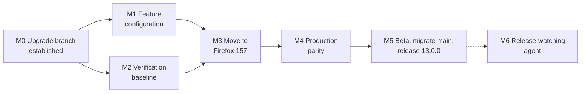

# Firefox Upgrade to 157: Milestones

**Audience:** iOS engineering and product (engineers: see [spec.md](spec.md) for tickets and work split)
**Owner:** Dario Carlomagno (one additional engineer on a best-effort basis)
**Outcome:** Ecosia 13.0.0, built on the latest Firefox iOS release, with every behavior we ship in production today, and a repeatable upgrade process that an agent can later run.

## Why we are doing this now

The Ecosia iOS app is built on top of Firefox iOS. Our production app sits on Firefox 147, which we adopted in January 2026. Firefox has since shipped ten major versions, and 157 is current. The further behind we fall, the larger and riskier each upgrade becomes: the jump from 147 to 155 alone spans almost 1,800 upstream changes, touching about 100 of the Firefox files we customize.

Upgrades have so far happened about twice a year, as large one-off projects. Our north star is to make them routine, eventually with an agent that watches Firefox releases, assesses what changed, and recommends whether to take a release now or wait and bundle it with the next one. That is only realistic once we are current and the process is repeatable, so this upgrade is designed to get us there.

## How we got to this approach

**An experiment proved the hard part can be agent-assisted.** In September, Jörn ran an agent-assisted upgrade from Firefox 147 to 155.1 on a separate branch. The agent first inventoried every Ecosia customization, then resolved conflicts area by area against that inventory. The result builds and passes all 947 unit tests. The plan, the inventory and a list of pitfalls ("traps") found along the way are all reusable.

**But that work could not be brought back into `main`.** Like past upgrades, it was built on Firefox's history rather than ours, while `main` kept moving with about two dozen new pull requests. Our documented process handles this by cherry-picking every new `main` commit across by hand, then replacing `main` through branch renames and a force push. That is slow, error-prone, and a single high-risk switch at the end.

**So we graft the upgrade onto `main`'s history** (see [upgrade ADR 0001](../../firefox-ios/EcosiaUpgrade/adr/0001-graft-firefox-upgrades-onto-main-via-upgrade-branch.md)). The upgrade becomes one commit on a long-lived branch, `upgrade/firefox`, that starts from `main`. Because the branch shares history with `main`, new production work flows in through ordinary automatic merges. A test run merging two weeks of `main` into the grafted branch conflicted in only 4 files. When we are ready, `main` simply moves forward to the upgrade branch, with no force push, and the old `main` is kept as an archive branch for patching the previous production version.

**We stop at 155.1 first, then move to 157.** The 155.1 work is already verified, so we reuse it as an internal checkpoint rather than redo it. The step from 155.1 to 157 is small: it touches 26 of our customized files, against about 100 for the first jump. Full QA, the beta and the `main` migration are the most expensive steps for a team of our size, so we do each of them only once, on 157.

**`main` keeps shipping production throughout.** No upgrade work lands in `main` until we decide to migrate it.

## Product decisions

| Firefox feature | Decision |
| --- | --- |
| Translations | Keep |
| Page summaries | Keep, on-device only. Hidden entirely on devices that cannot summarize on-device |
| AI controls settings hub | Keep, showing only translations and summaries |
| Google Lens | Out |
| Quick Answers (voice) | Out |
| VPN promotion | Out |
| Ad blocker | Out for now: its block list hides the ads on Ecosia's own search results, which fund tree planting |
| "Nova" visual redesign | Off |

Two follow-ups are tracked separately and do not block any milestone: an Ecosia-owned server for page summaries, so that devices without on-device AI also get the feature, and an investigation into whether we can offer the ad blocker long term without it blocking Ecosia's own ads.

## Upgrade diary

Past upgrades kept a diary, and it repeatedly helped trace issues found in QA back to the decision that caused them. This upgrade keeps one from day one, in the repository at `firefox-ios/EcosiaUpgrade/diary/`, so engineers and agents can both read it and add to it.

- One diary per upgrade. The 155.1 checkpoint section is seeded from the experiment's tickets and trap list.
- Each entry is dated and records who wrote it (engineer or agent), the milestone, what was done, what was decided and why, and any new trap worth checking next time.
- A milestone only counts as done once its diary entry is written.
- Agents working on the upgrade write to the same diary as engineers, so their reasoning can be reviewed like anyone else's.

## Milestones

Sizes assume one full-time owner plus one engineer at best effort. Weeks are elapsed time, not effort. The focused estimate assumes uninterrupted work and that team review and QA are available when needed; the planning range adds about 20% for absences, holidays and waiting on reviewers.

| Milestone | Status | Size | Weeks | Runs in parallel with |
| --- | --- | --- | --- | --- |
| M0 Upgrade branch established | In progress | S | ~1 | — |
| M1 Feature configuration | Not started | S | 1–2 | M2 |
| M2 Verification baseline | Not started | M | 1–2 | M1 |
| M3 Move to Firefox 157 | Not started | M | 2–3 | — |
| M4 Production parity | Not started | L | 3–4 | Split by feature area |
| M5 Beta, migrate `main`, release 13.0.0 | Not started | M | 2–4 | — |
| **Total to release, focused** | | | **~9–14** | |
| **Total to release, planning range** | | | **~11–17** | |
| M6 Release-watching agent | Next phase | To be scoped | — | — |

### M0: Upgrade branch established

**Status:** in progress.

**Goal:** the 155.1 upgrade lives on `upgrade/firefox`, branched from today's `main`, and stays current automatically.

- Graft the experimental 155.1 work onto `main` and resolve the conflicts with work merged since (4 files today).
- Build, and run the full unit test suite.
- Record which Firefox release the branch is built on, so later upgrades know where they start from.
- A CI job merges `main` into the upgrade branch after every merge to `main`, builds and tests, and alerts the owner on conflicts.
- Branch rules match `main`: reviewed pull requests only, same CI checks.
- Start the upgrade diary, seeded with the 155.1 experiment's findings.

**Done when:** the branch builds, all tests pass, and a merge to `main` shows up on the upgrade branch without manual work.

### M1: Feature configuration

**Goal:** the app exposes exactly the Firefox features decided above.

- Switch Google Lens, Quick Answers, VPN and the ad blocker off through feature-flag configuration rather than code changes, so the choices survive future upgrades cheaply.
- Remove the speech-recognition permission prompt that only Quick Answers needed.
- Make sure no page content is sent to Mozilla's servers for summaries.
- Restrict summaries to on-device, and hide every entry point on devices that do not support it.
- Confirm the Nova redesign stays off.
- Add automated tests that lock these decisions in.

**Done when:** each decision is covered by a test and confirmed on a device.

### M2: Verification baseline

**Goal:** we can prove the upgraded app matches production, not just that it builds.

- Run our existing screenshot tests (`EcosiaSnapshotTests`) on the upgrade branch. Their reference images come from production, so every difference is either a regression or an intended change.
- Re-run the check that every Firefox function our code depends on still exists.
- Clear the cleanup items the 155.1 experiment left behind, so they do not mislead the next step.

**Done when:** screenshot tests run on the upgrade branch, and every difference from production is either fixed or accepted as intended.

### M3: Move to Firefox 157

**Goal:** the upgrade branch is built on the latest Firefox release at the time this step starts (157.x today). The target is then fixed; anything newer waits for the next upgrade.

- Apply the Firefox changes from 155.1 to 157 against our customizations, reusing the inventory, tooling and trap list from the experiment.
- Re-check the feature configuration against any new Firefox flags.
- Move the upgrade tooling into its own Ecosia-owned folder (`firefox-ios/EcosiaUpgrade`).
- Record every conflict pattern and new trap from this step in the diary; it is the first upgrade step we expect an agent to repeat.

**Done when:** the branch builds on 157, all unit and snapshot tests pass, and the M1 decisions still hold.

### M4: Production parity

**Goal:** the upgraded app does everything production does today, plus exactly the approved features.

- Create the upgrade test plan from our Miro template, covering the new Firefox features and everything changed under our customizations.
- The whole team reviews each feature area together: toolbar, menu, homepage, bookmarks, settings, tracking protection, onboarding.
- Test updating from the current App Store version (12.6.x), and from the oldest version still widely used, keeping user data intact. This gap caused issues in a past upgrade.
- Run QA's regression checklist on devices and fix what it finds.

**Done when:** the test plan and regression checklist pass, and the team agrees the branch matches production.

### M5: Beta, migrate `main`, release 13.0.0

**Goal:** the upgrade reaches users safely.

- Beta through Firebase, with a fix loop on the upgrade branch.
- When the team decides it is ready, migrate `main`: keep today's `main` as `main-147` for any patch to the current version, then move `main` forward to the upgrade branch and delete the upgrade branch.
- Bump the version to 13.0.0 and release with a staged rollout, watching crashes and user reports.

**Done when:** 13.0.0 is fully rolled out and stable.

### M6: Release-watching agent (next phase)

**Goal:** upgrades become routine instead of a twice-yearly project.

Once we are at production parity on the latest Firefox, an agent watches new Firefox releases, assesses how they affect our customizations, and recommends whether to take each release now or wait and bundle it. The tooling, trap list and diary from M0–M5 are its starting point. The agent keeps its own diary: every release it assesses gets an entry with what changed, how it affects our customizations, and why it recommended taking or waiting. That gives the team an audit trail for each recommendation, and gives the agent a memory across releases. Its design and scope will be planned when M5 is close, so it benefits from what this upgrade teaches us.

The planned steps, already in the upgrade epic:

- Design the agent with the team and product, including the criteria for taking a release now or bundling it.
- Detect new Firefox releases automatically.
- Assess each release against our customizations and recommend take now or wait, checked first against the 155.1 to 157 step we just did.
- Keep the agent's diary.
- Have the agent prepare the upgrade as a draft pull request when the team decides to take a release.
- Pilot it on the first Firefox release after 13.0.0, compare it with a human assessment, and decide whether to keep it.

The agent never merges or releases; the team makes every decision.

## Risks

- **A clean merge can still break behavior**, for example when `main` changes code the upgrade restructured elsewhere. Every automatic merge therefore builds and runs the tests, not only merges.
- **Capacity.** With one full-time engineer, team review and QA (M4) are the bottleneck. Splitting review by feature area keeps it moving.
- **Firefox keeps shipping.** The target is fixed when M3 starts; newer releases become input for M6.
- **Hot files.** A few Firefox files are heavily changed by the upgrade (browser view, tab management, homepage). Changes to them on `main` should give the owner a heads-up.
