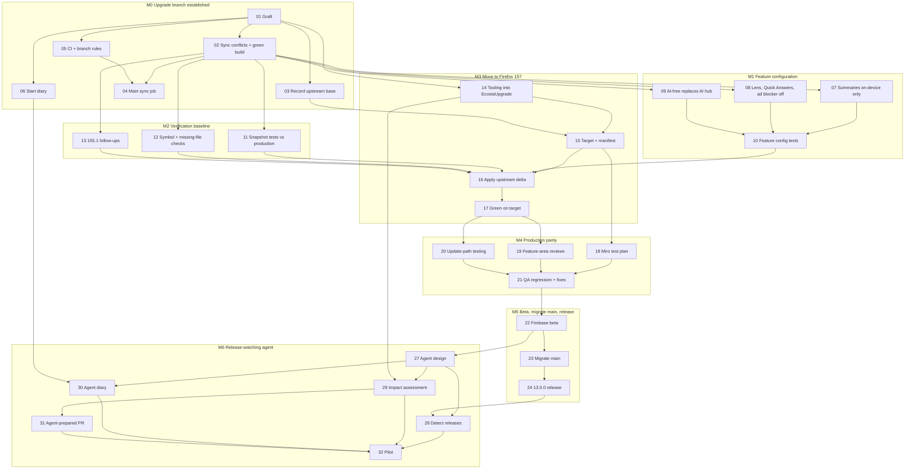

# Firefox Upgrade to 157: Engineering Plan

**Audience:** iOS engineers working on the upgrade
**Owner:** Dario Carlomagno, plus one engineer at best effort
**Read alongside:** [milestones.md](milestones.md) (the shared overview), [upgrade ADR 0001](../../firefox-ios/EcosiaUpgrade/adr/0001-graft-firefox-upgrades-onto-main-via-upgrade-branch.md) (why we graft), [the upgrade glossary](../../firefox-ios/EcosiaUpgrade/GLOSSARY.md) (vocabulary used below)

This document turns the milestones into tickets that two people can split. Every ticket lives in [`issues/`](issues/) as its own file, with a `Milestone:`, `Status:` and `Blocked by:` line.

## Where we start

| Thing | State on 2026-10-01 |
| --- | --- |
| Production (`main`) | Ecosia 12.6.0 on an upstream base of Firefox 147.2 (in practice upstream commit `52d1a5f`, a 149 nightly two files away from the `firefox-v147.2` tag) |
| Experimental upgrade | `firefox-upgrade-155.1` ([PR #1294](https://github.com/ecosia/ios-browser/pull/1294)): `firefox-v155.1` + one squash commit of Ecosia's layer (`c162a7c953`) + a docs/manifest commit (`a9bd75f175`) + 7 CI experiment commits. Builds; `EcosiaTests` 947 passing |
| Squash point | `main` at `89e13a568d` (Sep 9). The Ecosia module is identical there and in the squash commit |
| `main` since the squash point | ~24 PRs, 70 files, 9 of them Firefox-core |
| Graft dry run | Merging today's `main` into the grafted 155.1 conflicts in 4 files: `TabManagerImplementation.swift` (3 hunks), `TabManager.swift` (1), `MockTabManager.swift` (1), `Gemfile.lock` (2) |
| Latest Firefox | `firefox-v157.0` (Sep 18); `release/v157.1` in progress. 155.1 → 157.0 is 148 upstream commits touching 26 Ecosia-customized core files |

## Technical approach

### The graft (M0)

The upgrade tree from the experiment becomes a single commit whose parent is the squash point, then today's `main` is merged into it:

```sh
GRAFT=$(git commit-tree "<cleaned 155.1 tree>" -p 89e13a568d -m "[UPGRADE-155] Graft Firefox 155.1 upgrade onto main")
git switch -c upgrade/firefox "$GRAFT"
git merge origin/main
```

Use the squash commit's tree (`c162a7c953`) as the starting point, not the branch tip. The tip also carries the CI experiments and the docs commit, which also changed `version.xcconfig`, `swiftlint_baseline.json`, `webpack.config.js` and the Tuist scripts. Carry the manifest, scripts and the 19 experiment tickets into `firefox-ios/EcosiaUpgrade/` instead (ticket 06 seeds the diary from them), and re-apply only the Fastfile change from `8470b74e03` if CI still needs it.

### Main sync (continuous)

Because `upgrade/firefox` descends from `main`, keeping it current is `git merge origin/main`. A CI job does that after every merge to `main` (ticket 04). A clean merge is not proof of correctness: every sync builds and runs the unit tests.

### Moving to the upgrade target (M3)

Firefox's history is no longer in our ancestry, so `git merge-base` cannot find the upstream base. It is recorded in `firefox-ios/EcosiaUpgrade/UPSTREAM_BASE` (ticket 03). The upstream delta is applied against that recorded base:

```sh
BASE=$(cat firefox-ios/EcosiaUpgrade/UPSTREAM_BASE | cut -f1)   # e.g. firefox-v155.1
git merge-tree --write-tree --merge-base="$BASE" HEAD firefox-v157.0
```

`git merge-tree` needs git 2.40 or newer. The output tree, once conflicts are resolved, becomes one commit on `upgrade/firefox`.

### Migrating `main` (M5)

When the team decides:

```sh
git push origin origin/main:refs/heads/main-147      # archive, and base for any 12.x patch
git push origin origin/upgrade/firefox:main          # fast-forward; fails if main has unsynced commits
git push origin --delete upgrade/firefox
```

A patch to the previous production version is cut from `main-147`, bumped there, and the fix is merged back into `main`.

## Work lanes

Two lanes after M0: **O** is the owner, **S** is the second engineer at best effort. Tickets in S's lane are ones that can wait a few days without blocking the critical path.



## Ticket index

All tickets live under the Jira epic [MOB-5026: Firefox 157.x Upgrade (Ecosia 13.0.0)](https://ecosia.atlassian.net/browse/MOB-5026), as MOB-5027 (01) to MOB-5058 (32) in order. Acceptance criteria are Jira action items, ticked off in the ticket. Jira is the source of truth for status; the Status column below is the local triage label.

| # | Ticket | Milestone | Lane | Blocked by | Status |
| --- | --- | --- | --- | --- | --- |
| 01 | [Graft 155.1 onto `main` as `upgrade/firefox`](issues/01-graft-155-1-onto-main.md) | M0 | O | — | ready-for-human |
| 02 | [Resolve sync conflicts and get a green build](issues/02-resolve-sync-conflicts-green-build.md) | M0 | O | 01 | ready-for-human |
| 03 | [Record the upstream base](issues/03-record-upstream-base.md) | M0 | S | 01 | ready-for-agent |
| 04 | [Automatic main sync job](issues/04-automatic-main-sync-job.md) | M0 | O | 02, 05 | ready-for-human |
| 05 | [CI and branch rules for `upgrade/firefox`](issues/05-ci-and-branch-rules.md) | M0 | O | 01 | ready-for-human |
| 06 | [Start the upgrade diary](issues/06-start-upgrade-diary.md) | M0 | S | 01 | ready-for-agent |
| 07 | [Summaries on-device only](issues/07-summaries-on-device-only.md) | M1 | O | 02 | ready-for-agent |
| 08 | [Google Lens, Quick Answers and ad blocker off](issues/08-google-lens-quick-answers-off.md) | M1 | S | 02 | ready-for-agent |
| 09 | [AI-free searching replaces the AI controls hub](issues/09-ai-controls-hub.md) | M1 | O | 02 | ready-for-agent |
| 10 | [Lock the feature configuration with tests](issues/10-feature-configuration-tests.md) | M1 | O | 07, 08, 09 | ready-for-agent |
| 11 | [Run snapshot tests against production references](issues/11-snapshot-baselines.md) | M2 | S | 02 | ready-for-human |
| 12 | [Symbol-dependency and missing-file checks](issues/12-symbol-and-missing-file-checks.md) | M2 | S | 02 | ready-for-agent |
| 13 | [Clear the 155.1 follow-ups](issues/13-clear-155-1-follow-ups.md) | M2 | S | 02 | ready-for-agent |
| 14 | [Move and fix the upgrade tooling](issues/14-move-and-fix-upgrade-tooling.md) | M3 | S | 01 | ready-for-agent |
| 15 | [Fix the upgrade target and build its manifest](issues/15-upgrade-target-and-manifest.md) | M3 | O | 03, 14 | ready-for-human |
| 16 | [Apply the upstream delta to the target](issues/16-apply-upstream-delta.md) | M3 | O | 10, 11, 12, 13, 15 | ready-for-human |
| 17 | [Green build and tests on the target](issues/17-green-on-target.md) | M3 | O | 16 | ready-for-human |
| 18 | [Upgrade test plan in Miro](issues/18-miro-test-plan.md) | M4 | S | 15 | ready-for-human |
| 19 | [Feature-area reviews](issues/19-feature-area-reviews.md) | M4 | O + team | 17 | ready-for-human |
| 20 | [Update-path testing](issues/20-update-path-testing.md) | M4 | S | 17 | ready-for-human |
| 21 | [QA regression and fix loop](issues/21-qa-regression-and-fixes.md) | M4 | O + QA | 18, 19, 20 | ready-for-human |
| 22 | [Firebase beta](issues/22-firebase-beta.md) | M5 | O | 21 | ready-for-human |
| 23 | [Migrate `main`](issues/23-migrate-main.md) | M5 | O | 22 | ready-for-human |
| 24 | [Release 13.0.0](issues/24-release-13-0-0.md) | M5 | O | 23 | ready-for-human |
| 25 | [Ecosia-owned server-side summaries](issues/25-ecosia-server-side-summaries.md) | Follow-up | — | — | needs-triage |
| 26 | [Investigate keeping the ad blocker long term](issues/26-ad-blocker-long-term-feasibility.md) | Follow-up | — | 08 | needs-triage |
| 27 | [Design the release-watching agent](issues/27-design-release-watching-agent.md) | M6 | O | 22 | needs-triage |
| 28 | [Detect new Firefox releases](issues/28-detect-new-firefox-releases.md) | M6 | S | 24, 27 | needs-triage |
| 29 | [Release impact assessment and recommendation](issues/29-release-impact-assessment.md) | M6 | O | 14, 27 | needs-triage |
| 30 | [Agent diary](issues/30-agent-diary.md) | M6 | S | 06, 27 | needs-triage |
| 31 | [Agent-prepared upgrade PR](issues/31-agent-prepared-upgrade-pr.md) | M6 | O | 27, 29 | needs-triage |
| 32 | [Pilot on the first Firefox release after 13.0.0](issues/32-agent-pilot.md) | M6 | O + team | 28, 29, 30, 31 | needs-triage |

M0 is already under way: update the `Status:` line of each M0 ticket to reflect what is done.

## Working rules

- **Every ticket ends with a diary entry** in `firefox-ios/EcosiaUpgrade/diary/`: date, author (engineer or agent), ticket, what was done, what was decided and why, new traps. This applies to agents too.
- **Changes reach `upgrade/firefox` through reviewed PRs** with the same CI as `main`. Main-sync merges are the only automated pushes.
- **Feature decisions are configuration, not code**, wherever a Nimbus flag exists: override the channel entry in `firefox-ios/nimbus-features/*.yaml` with a `# Ecosia:` reason, and list `release` explicitly instead of relying on upstream's variable default.
- **Hot files on `main`** (`BrowserViewController*`, `TabManagerImplementation`, `TabManager`, homepage and bookmarks controllers, toolbar Redux state): changes there ping the owner, since they conflict with the upgrade most.
- **Before resolving a test-file conflict in favour of our side,** check that our side is a real customization and not just an older Firefox (trap 6 from the 155.1 experiment, `issues/19-integrate-and-verify.md` in the diary's seed material).
