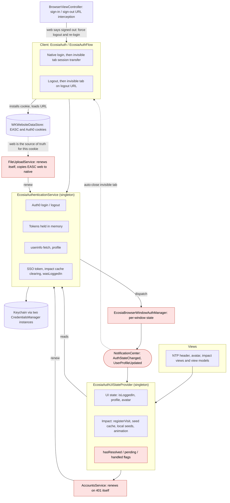
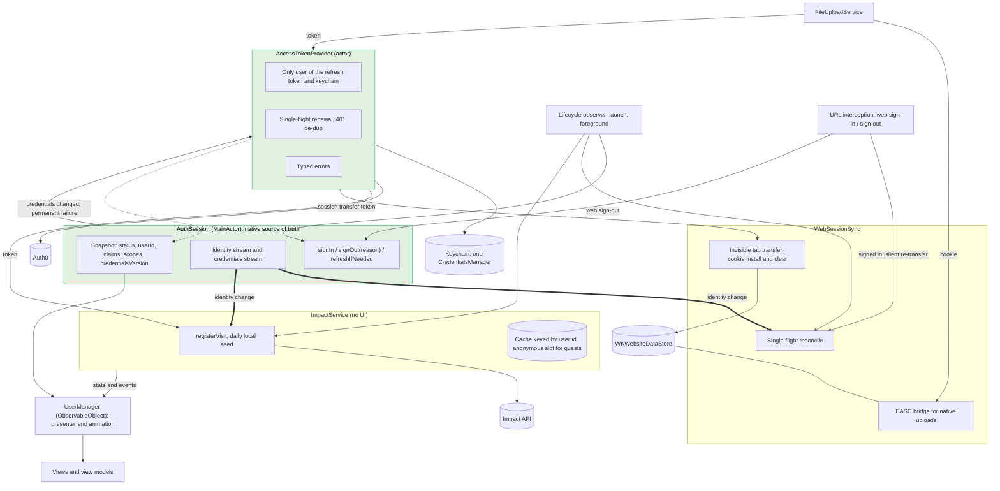
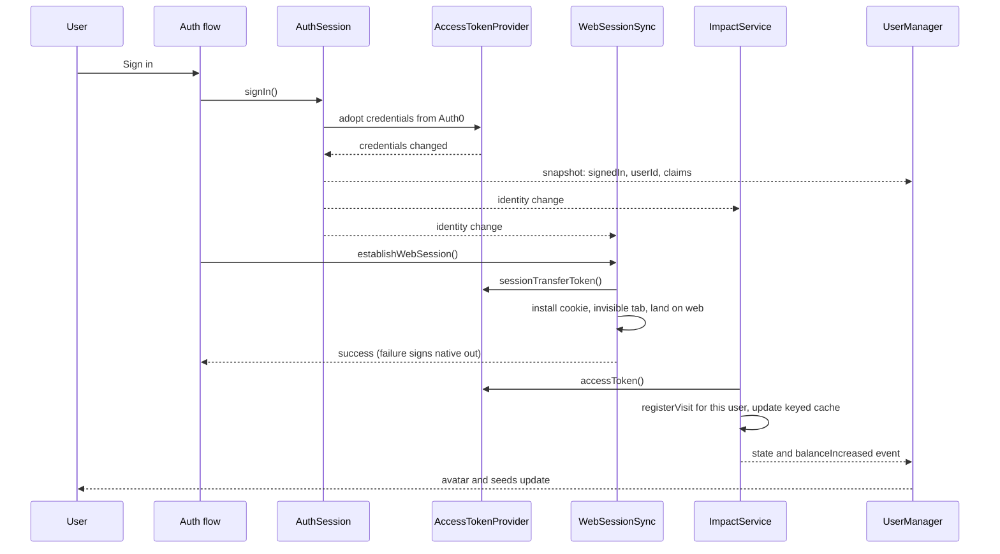
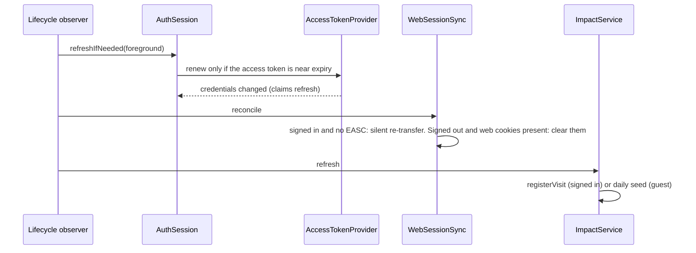

# Auth / WebSession / Impact restructure: migration plan

Destination of the map in `map.md`. Plan only; nothing is implemented. Detail for each decision lives in its ticket under `tickets/`; this page is the reading order.

## Constraints
- Minimum OS **iOS 15**: Combine, actors, `async/await`, `ObservableObject` only. No `@Observable`, no `Task.sleep(for:)`.
- Production is **v12.6.0**; every step keeps its persisted state readable (see the map's "Compatibility with released versions").
- Native is the source of truth for auth; the web session is kept in sync from native. Impact API logic is separate from auth.
- Never add Sentry logging. Rotation is deferred, not part of this plan.

## How it works today

Auth, web sync and impact are tangled in two singletons, with no single place that reacts to a change.

Pain points (red):
- No event when tokens or claims change; the provider polls the service when a notification happens to arrive.
- Notifications only reach registered windows, so launch-time resolution can be missed; the flags exist to compensate.
- Every consumer renews credentials itself, so renewals are not coordinated.
- The web session is only synced at login and logout; the web can silently diverge, and a web sign-in redirect forces a logout and re-login.
- Native uploads depend on a cookie that only the web owns.

## How it will work

Four layers, each depending only on the one above, all driven by one published auth snapshot.

Thick arrows are the reactive links: a change of user triggers web sync and impact on its own, with no notification round-trip. A refresh that only renews tokens does not retrigger either.

### Login, end to end

### Foreground, end to end

## Target architecture
Four layers, each depending only on the one above:
1. **`AuthSession`** (`@MainActor`): immutable snapshot (`status` unresolved/signedOut(reason)/signedIn, `userId`, raw claims, `grantedScopes`, `credentialsVersion`; never tokens) with identity and credentials streams. Owns the gateway. Tickets 01, 04.
2. **`AccessTokenProvider`** (actor): the only user of the refresh token and the keychain; single-flight renewal, SSO exchange routed through it; `accessToken(minimumValidity:requiringScopes:)`, `accessToken(rejecting:)`, `sessionTransferToken()`; typed errors. Tickets 02, 05.
3. **`WebSessionSync`**: invisible-tab session transfer, cookie install/clear, `EASC` upload bridge, one app-wide single-flight reconcile, own state publisher. Tickets 03, 06.
4. **`ImpactService`** (no UI) with stateless helpers and a user-keyed cache, then the **`UserManager`** presenter binding auth and impact for views. Tickets 07, 08.

## PR chain
| # | PR | Behaviour change |
|---|---|---|
| 1 | **Token gateway**: `AccessTokenProvider` actor over a single `CredentialsManager` (default store key); single-flight renewal; SSO exchange routed through it; typed errors; `AccountsService`/`FileUploadService` use it; second `DefaultCredentialsManager` removed. | Renewal only when needed (was forced on every launch, 401 and upload) |
| 2 | **`AuthSession`**: snapshot, identity + credentials streams, claims from the ID token, sign-out reasons, persisted `lastKnownUserId`, one-time read of legacy `wasLoggedIn`. `EcosiaAuthenticationService` becomes a thin facade and still posts legacy notifications derived from the snapshot. | Offline launch stays signed in; no `/userinfo` |
| 3 | **Foreground refresh**: lifecycle observer feeds `refreshIfNeeded(trigger: .foreground)`. | Foreground refresh |
| 4 | **Impact storage**: cache keyed by `sub`, anonymous slot on the existing seed keys, one-time migration of the legacy unkeyed `LoggedInImpactCache.*` slot. Provider uses it. | None (migration only) |
| 5 | **`ImpactService`**: stateless helpers + stateful service reacting to identity stream, foreground, NTP appear; userId stale-response guard; `AccountsService` drops its token parameter; `EcosiaAuthUIStateProvider` slims down; `hasResolved...` machinery removed. | None intended |
| 6 | **`WebSessionSync` extraction**: invisible-tab handoff, cookie install/clear and the `EASC` upload bridge move over; tab completes by its own landing detection (no per-window notification). | None intended |
| 7 | **Reactive web sync** (behind one Unleash flag): foreground/identity reconcile, silent re-transfer replacing forced logout + re-login (loop-guarded), one 403 retry on uploads. | New web behaviours |
| 8 | **`UserManager` binding**: presenter binds snapshot + `ImpactService` state/events; views migrate; animation moves in unchanged; `refreshFailed` toast. | None |
| 9 | **Bridge and dead-code removal**: `EcosiaBrowserWindowAuthManager`, `EcosiaAuthWindowRegistry`, `.EcosiaAuthStateChanged`, `.EcosiaUserProfileUpdated`, `DataClearingIntegration`, the `EcosiaAuthenticationService` facade. | None |
| 10 | **Mechanical rename** to `UserManager`, singleton accessor tidy-up. | None |

Each step: compiles on iOS 15, keeps v12.6.0 persisted state readable, ships its own tests (see ticket 09). One PR per step, each targeting the previous.

## If rotation is ever enabled (not part of this plan)

Deferred by Paul: this effort neither designs for nor schedules refresh-token rotation. Enabling it later is its own piece of work, with these facts to start from:
- It is a per-client Auth0 setting, so it affects every installed version at once. Builds up to 12.6.0 call `ssoExchange` at sign-in and discard the rotated refresh token it returns; the next renewal after the `leeway` would then look like reuse and revoke the token family (inferred, never run against a rotating tenant; verify with a 12.6.0 build on dev first).
- On the new gateway the change is one focused PR: share one in-flight slot between renewal and SSO exchange, persist the refresh and ID tokens those calls return, and set a `leeway` (the desktop client uses 30 s). The gateway being the only user of the refresh token is what keeps that small.
- A new Auth0 client id for new builds is ruled out. Gating options left: an adoption threshold or a forced update.
- Research detail: `tickets/02-rotation-and-sso-exchange.md`.

## Open dependency
The AI worker authenticates uploads from the access token inside `EASC` and ignores the Bearer header. Bearer support is a backend change outside this plan; if it lands, the `EASC` upload bridge in `WebSessionSync` can be deleted.
