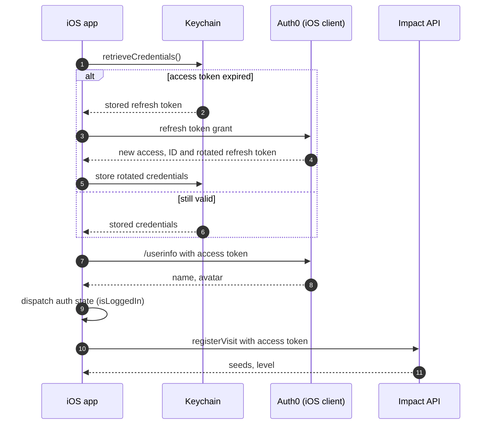
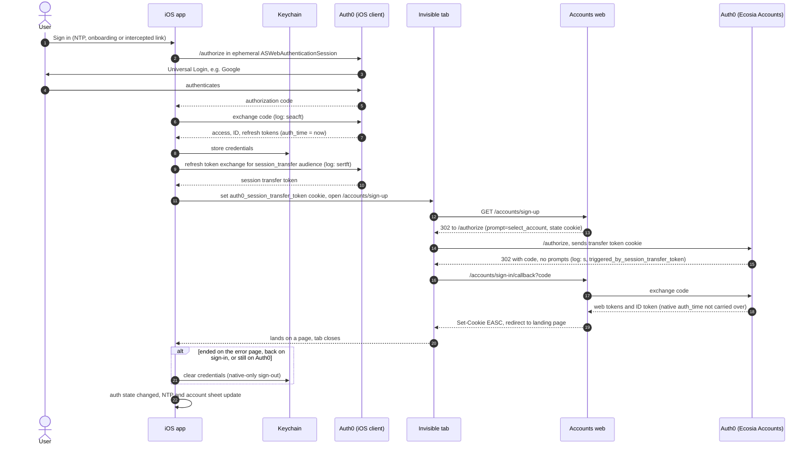
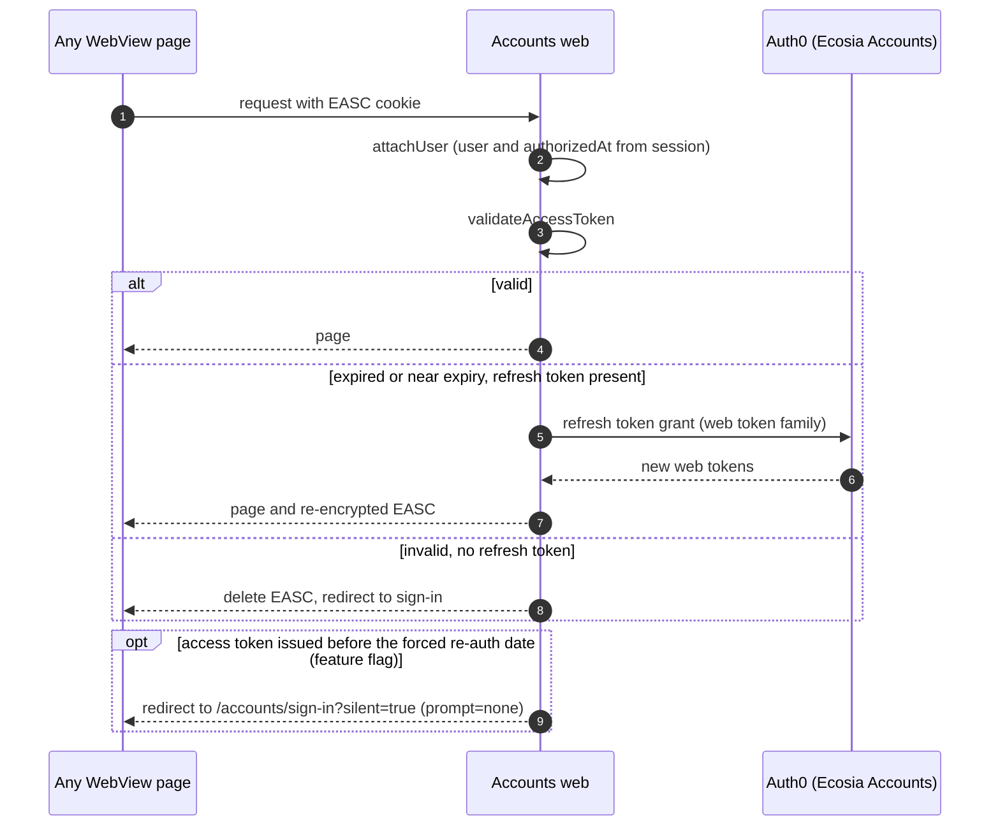
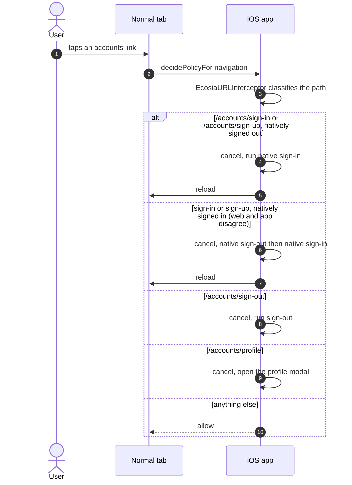
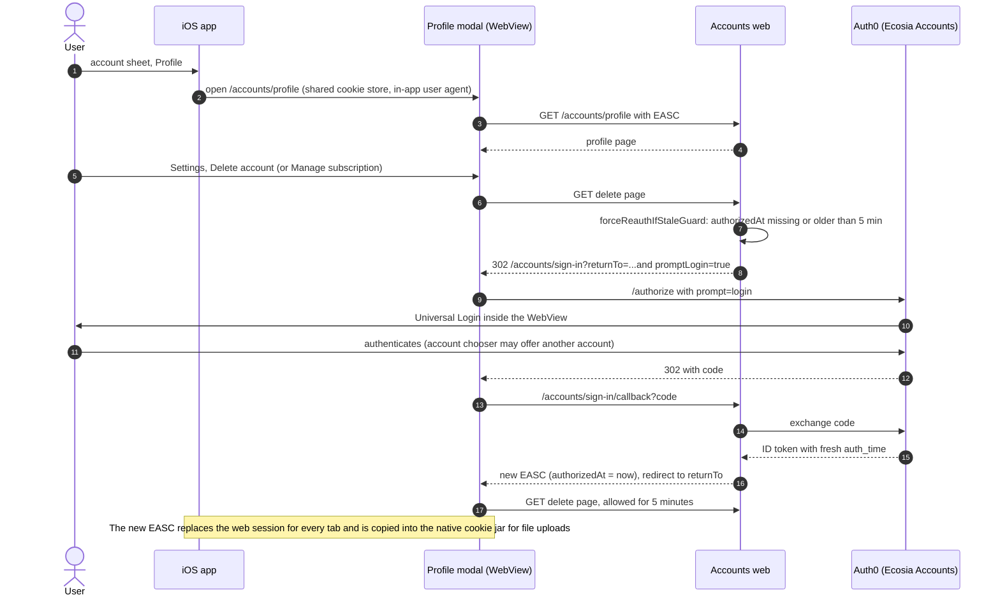
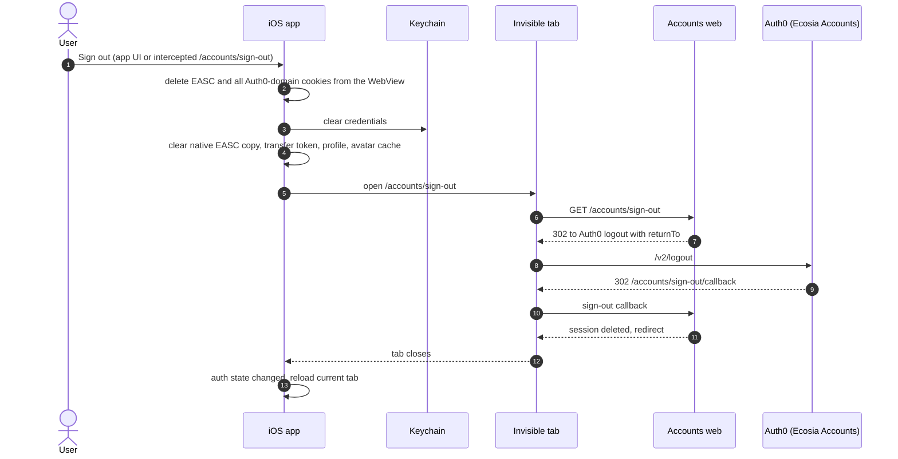

# Auth Flows

How a user signs in, stays signed in, re-authenticates and signs out across the iOS app, the accounts web pages and Auth0.

The app and the web each hold their own login. They share one WebView cookie store, which is how the native login reaches the web, and how a web login can reach native code.

- [Where auth state lives](#where-auth-state-lives)
- [App launch](#app-launch)
- [Native sign-in and session transfer](#native-sign-in-and-session-transfer)
- [Web session upkeep](#web-session-upkeep)
- [Auth links in a tab](#auth-links-in-a-tab)
- [Profile and re-auth for sensitive pages](#profile-and-re-auth-for-sensitive-pages)
- [Sign-out](#sign-out)
- [Known gaps](#known-gaps)

## Where auth state lives

| Store | Holds | Written by | Cleared by |
| --- | --- | --- | --- |
| Keychain | Native access, ID and refresh tokens (Auth0 client "Ecosia iOS Browser"). Refresh tokens rotate. | Native sign-in, renewal on expiry or forced renewal | Native sign-out, failed session transfer |
| App memory | Session transfer token (lives about 60s), user profile from `/userinfo` | Each sign-in, before the transfer | Native sign-out |
| WebView cookies | `auth0_session_transfer_token` on the Auth0 domain | App, just before the invisible tab opens | Used up by Auth0, expiry, native sign-out |
| WebView cookies | `EASC`: the web session (web tokens and the user, including `authorizedAt`) | Web sign-in callback, web token refresh | Web sign-out callback, native sign-out |
| WebView cookies | Auth0 session cookies on `login.<domain>` | Any web login inside the WebView | Native sign-out (deletes every Auth0-domain cookie) |
| Native cookie jar | Copy of `EASC` in `HTTPCookieStorage.shared`, used by native file uploads | `AuthSessionCookieHandler`, whenever the WebView's `EASC` changes | Native sign-out |

The WebView cookie store is `WKWebsiteDataStore.default()`, shared by every normal tab, the invisible auth tab and the profile modal.

## App launch

Launch restores the native login only. Nothing touches the web session, which keeps whatever `EASC` the WebView already has.

- **No forced renewal at launch.** Renewal only happens when the token has expired, because each renewal spends a rotating refresh token.
- **Forced renewal elsewhere.** Callers that need fresh claims or scopes, such as file upload, call `renewCredentials()` themselves.

Code: `EcosiaAuthenticationService.retrieveStoredCredentials()`, `renewCredentials()`, `EcosiaAuthUIStateProvider`.

## Native sign-in and session transfer

The user signs in once, natively. The app then hands that login to the web through Auth0's Native to Web SSO, using an invisible tab, so the web pages are signed in too.

- **Every native login is a real sign-in.** The ephemeral session never reuses an Auth0 session, so steps 3 and 4 always ask the user.
- **Two Auth0 clients, two token families.** The app and the web each end up with their own tokens. The transfer token is the only link between them.
- **The web builds the transfer request.** It sends `prompt=select_account` and only passes through `promptLogin` (as `prompt=login`) and `silent` (as `prompt=none`). With `prompt=login`, Auth0 shows Universal Login instead of completing the transfer.
- **The web's login is never fresh after a transfer.** The transfer login doesn't carry the native `auth_time`, so `authorizedAt` isn't recent even straight after sign-in.

Code: `EcosiaAuthFlow.performSessionTransfer`, `NativeToWebSSOAuth0Provider`, `InvisibleTabSession`. Web (ecosia/core): `accounts/pages/src/server/handlers/auth/sign-in.js`, `sign-in-callback.js`, `accounts/client-js/src/server/utils/oauth2.js`.

## Web session upkeep

Once `EASC` exists, the web keeps itself alive with its own refresh token. The app isn't involved.

- **Refreshes don't change `authorizedAt`.** Only a login through the sign-in callback sets it.
- **Separate from native renewal.** Native and web refresh tokens rotate independently.

Web (ecosia/core): `accounts/client-js/src/server/hooks/attach-user.js`, `validate-access-token.js`, `refresh-access-token.js`, `force-re-auth.js`.

## Auth links in a tab

When a page in a normal tab navigates to an accounts URL, the app cancels the navigation and runs the native flow instead.

- **The invisible tab is never intercepted**, so its own redirects through `/accounts/sign-up` and the callback go through.
- **The profile modal isn't intercepted either.** It has its own navigation delegate, so a sign-in inside it is a web login.

Code: `BrowserViewController+Ecosia.detectAndHandleEcosiaURL`, `EcosiaURLInterceptor`.

## Profile and re-auth for sensitive pages

The profile is a web page in a modal. Deleting the account and managing a subscription need a login from the last 5 minutes, which the transfer login never provides, so the user always logs in again on the web.

- **It always prompts.** Even straight after a native sign-in, because the transfer login doesn't carry the native `auth_time`.
- **Google login runs inside the WebView.** It works with the in-app user agent, but Google can block embedded logins, which is why the modal reports Google OAuth navigations to Sentry.
- **The user can pick a different account here.** The web would then act as that account while the app stays on the original one, until sign-out.

Code: `EcosiaWebViewModal`, `BrowserViewController+Ecosia.presentProfileModal`. Web (ecosia/core): `accounts/pages/src/server/routes/util.js`, `routes/profile/index.js`, `accounts/client-js/src/server/hooks/force-re-auth.js`.

## Sign-out

The app clears its own state first, then runs the web's sign-out in the invisible tab so Auth0's session ends too.

- **Clearing cookies is local.** The app deletes cookies itself rather than calling Auth0's logout from `ASWebAuthenticationSession`, which would show a system alert.
- **Everything a web login left behind goes too**, including Auth0 session cookies from a profile re-auth.

Code: `EcosiaAuthenticationService.logout`, `NativeToWebSSOAuth0Provider.clearSession`, `EcosiaAuthFlow.performSessionCleanup`. Web (ecosia/core): `accounts/pages/src/server/handlers/auth/sign-out.js`, `sign-out-callback.js`.

## Known gaps

- **The transfer login doesn't carry the native `auth_time`.** Auth0 treats it as a new web session, so the web's recent-login check never passes after a transfer. Options: an Auth0 Action that records the native login time in refresh token metadata and adds it to the web's ID token as a custom claim, or doing delete and subscription management natively.
- **A profile re-auth can sign the web in as a different account.** It isn't known whether the web checks that the re-auth user matches the existing session.
- **On the simulator, an old `EASC` can survive deleting the app.** Erase the simulator between auth tests, or test on a device.
