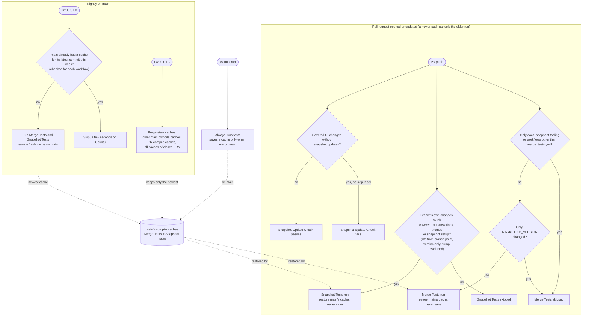

# 🔄 Test workflows and caching

How Merge Unit Tests, Snapshot Tests, Snapshot Update Check and the cache purge decide whether to run, and how they share Xcode compilation caches.

## Notes

- Merge Tests always start on pull requests and decide in their first job whether to run, so a change that needs no tests reports "Execute Merge Tests" as skipped, which counts as passing for a required check. A `paths-ignore` filter would not start the workflow at all, and a required check would then wait forever.
- Merge Tests and Snapshot Tests each keep their own compilation cache on `main` (`unit-tests` and `snapshot-tests`).
- A new push to a pull request cancels that pull request's running Merge Tests and Snapshot Tests. Runs on `main` (nightly and manual) are never cancelled, only queued.
- The purge runs two hours after the nightly refresh, so it keeps the cache just saved and deletes the previous night's.
- Cache keys include the ISO week and a hash of the Xcode version. The nightly check also refreshes when the week changes, so `main` gets a new cache at least once a week. Xcode is pinned in `prepare_environment`, so changing it means a commit to `main`, which the next nightly refresh picks up. If the runner image swaps in a different build of the pinned version, pull requests build without a cache until the next commit or week.
- Pull requests only restore caches. Each compilation cache is close to 1 GB, and per-commit pull request saves used to fill the repository's 10 GB cache limit, evicting `main`'s cache and causing cold builds of around 11 minutes instead of around 7.
- Commits merged during the day reach `main`'s cache that night. Until then pull requests restore the previous cache, which costs well under a minute of extra build time on average.
- Snapshot change detection diffs from the point where the branch left `main`, so commits merged into `main` afterwards never count as the branch's changes.

## Where it lives

| What | File |
| --- | --- |
| Merge tests triggers and version-bump skip | `.github/workflows/merge_tests.yml` |
| Snapshot tests triggers | `.github/workflows/snapshot_tests.yml` |
| Snapshot relevance and update check | `check_snapshot_updates.sh`, `firefox-ios/EcosiaTests/SnapshotTests/snapshot_coverage.json` |
| Snapshot update check workflow | `.github/workflows/snapshot_update_check.yml` |
| Version-only bump detection (shared) | `.github/scripts/only_marketing_version_changed.sh` |
| Compilation cache restore and save | `.github/actions/xcode_compilation_cache/action.yml` |
| Cache purge | `.github/workflows/purge_caches.yml`, `.github/scripts/purge_caches.sh` |

Manual runs of the purge default to a dry run that only lists what would be deleted.
