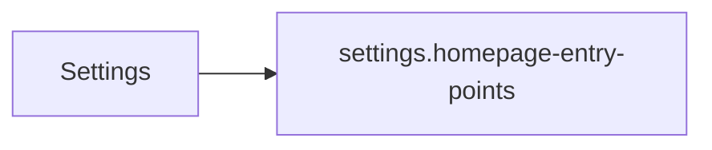

# Upgrade test plan

The flows that check a Firefox upgrade against production, written so that an agent driving the iOS Simulator can run them, and so that each one can later become an automated test. It replaces the Miro test plan (the 147 board and the template that step 6 of the Firefox Upgrades Confluence page pointed to).

The plan lives with the code: a change that adds or moves a customization updates its flow in the same PR.

```
test-plan/
  README.md          this file: the format and how to run it
  AGENT.md           how an agent runs the flows on the simulator
  map.md             Mermaid map of every area and flow, generated by tools/test_plan.py --map
  areas/<area>.md    the flows, one file per area; reused by every upgrade
  targets/<rel>.md   one upgrade only: new features, its migrations, intended visual changes
  runs/<rel>/*.md    results, one file per run
  uncovered.allow    +Ecosia extension files that need no flow, with the reason
```

## Who runs a flow

Every flow is an **agent flow** unless its metadata line says otherwise:

- **agent** (no marker, the default): an agent with the simulator runs it and judges from screenshots, as [AGENT.md](AGENT.md) describes. A person can run it the same way.
- **`automated: <test>`**: a unit, snapshot or UI test covers it in CI, so runs skip it. `<test>` is the test class or `Class/testMethod`; `test_plan.py --check` fails if it doesn't exist.
- **`human: <reason>`**: only when neither an agent nor a test can do it, and the reason says why, for example `human: Braze push`. The reason is required.

Every run reports the split (for example "52 agent · 9 automated · 3 human"). The goal is that the human share shrinks from one upgrade to the next and the automated share grows: a `human:` reason is a candidate ticket to remove it, and an agent flow that keeps finding regressions is a candidate for a UI or snapshot test.

## Area files

One Markdown file per area in `areas/`. `test_plan.py` parses these conventions, so keep them:

````markdown
# Settings

Covers:
- `firefox-ios/Client/Frontend/Settings/Main/AppSettingsTableViewController.swift`
- `firefox-ios/Client/Ecosia/Extensions/AppSettingsTableViewController+Ecosia.swift`



## settings.homepage-entry-points
p1 · origin MOB-5282 item 4

Homepage settings are the same screen from every entry point.

**Setup:** fresh install · de · compare with main

1. Open the main menu, then Settings, then Homepage. Screenshot.
2. Go back to the homepage, tap the customise button (`ntp_customize_button`). Screenshot.

**Expect:** both screens show the same rows in the same order, and match main.
````

- **Title:** `# <Area>`.
- **`Covers:`** the files the area exercises: Ecosia's `+Ecosia` extensions, the Firefox files they extend, and Ecosia-owned files where a regression would show here. `--affected` uses it to pick the flows a diff touches.
- **Diagram:** one `mermaid` block with every flow id of the file as a node (it is what the Miro mind map showed; GitHub renders it).
- **Flow:** a `## <area>.<slug>` heading (lowercase, dashes), then the metadata line, a one-line summary, `**Setup:**`, numbered steps and `**Expect:**`.
- **Metadata line:** fields joined by ` · `: the priority (`p1` checked on every upgrade, `p2` when the area changed, `p3` smoke), optionally `origin <ticket or source>`, and at most one of `automated: <test>` / `human: <reason>`.
- **Setup** words the runbook understands: `fresh install` (erase the simulator first), `update from main` (install main, create state, install the upgrade build over it), `existing` (any state), `en` / `de` (each listed locale is one run), `compare with main` (run on a main build side by side), `signed in as "<test account>"` (see [Test accounts](#test-accounts)), `network off`.
- **Steps** are plain language. Name an accessibility identifier in backticks where one exists (`EcosiaAccessibilityIdentifiers`, Firefox's `AccessibilityIdentifiers`); it makes converting the flow to XCUITest mechanical.
- **Expect** says what passes. "Matches main" means: same screen as the main build, apart from the intended changes listed in the target file.

## Target files

`targets/<release>.md` (for example [`160.1.md`](targets/160.1.md)) holds what only this upgrade needs, in the same flow format, plus:

- **Intended changes:** visual or behavioral differences from production that the upgrade means to bring (from the snapshot triage and the change inventory). A run that finds one of them records a pass, not a failure.
- **Migrations:** data or preference changes upstream made between the old base and the target; each one needs an `update from main` flow.

Copy the previous target file when a new upgrade starts, drop what shipped, and add the new inventory's **keep** features and migrations.

## Runs

A run is one runner, one device, one locale and one pair of builds. Generate the sheet, fill it in, commit it:

```bash
tools=firefox-ios/EcosiaUpgrade/tools
$tools/test_plan.py --todo 160.1 > firefox-ios/EcosiaUpgrade/test-plan/runs/160.1/2026-11-25-agent-iphone13mini-de.md
```

Each row gets a result: **pass**, **fail**, **blocked** (couldn't run; say why) or **not run**. A fail names the regression ticket (MOB-5047's children) or says it was accepted as an intended change. Screenshots stay out of git: attach them to the ticket and link them. A run ends with a diary entry, as every ticket does.

## Test accounts

Test accounts live in the team password manager's iOS QA vault, never in the repo, run files, diary or Jira. A flow names the account (`signed in as "iOS QA staging 1"`), not its value. Agents sign in only on the beta build, which uses `login.ecosia-staging.xyz`; production sign-in stays out of agent runs. [AGENT.md](AGENT.md) says how the password reaches the simulator without passing through the agent's transcript.

## Tool

```bash
tools=firefox-ios/EcosiaUpgrade/tools
$tools/test_plan.py --check                # format, ids, diagrams, coverage, automated tests exist; counts
$tools/test_plan.py --map                  # rewrite map.md
$tools/test_plan.py --affected origin/main..HEAD   # flows whose Covers files changed
$tools/test_plan.py --todo 160.1           # run sheet: every flow plus the target file
```

`--check` runs in `verify.sh`. It fails when a flow is malformed, an id repeats or is missing from its diagram, a required area has no file, an `automated:` test doesn't exist, or a `+Ecosia` extension file is neither covered nor listed in `uncovered.allow`.
