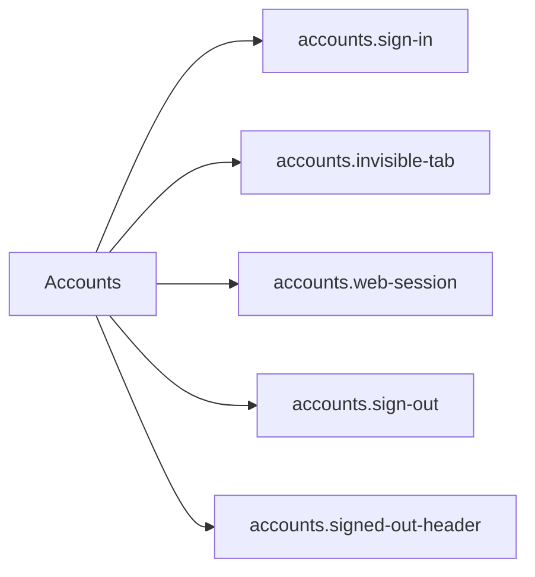

# Accounts

Ecosia accounts: sign in and out, the impact shown in the header, and the invisible tab that carries the web session.

Covers:
- `firefox-ios/Client/Ecosia/Account/`
- `firefox-ios/Ecosia/Account/`
- `firefox-ios/Ecosia/UI/Account/`
- `firefox-ios/Client/Ecosia/Extensions/TabData+EcosiaAuth.swift`
- `firefox-ios/Client/Ecosia/Extensions/Tab+Ecosia.swift`
- `firefox-ios/Client/Ecosia/Extensions/Tab+InvisibleTab.swift`
- `firefox-ios/Client/Ecosia/Extensions/TabManager+InvisibleTab.swift`
- `firefox-ios/Storage/RustKeychain+Ecosia.swift`

## accounts.sign-in
p1 · origin 147 board "Accounts"

Signing in from the homepage header.

**Setup:** fresh install · en · signed in as "iOS QA staging 1" (beta build)

1. Tap the account button (`account_nav_button`). Screenshot.
2. Sign in with the test account (password pasted from the vault, AGENT.md §5).
3. Back on the homepage, screenshot the header.

**Expect:** the sign-in page is Ecosia's (`login.ecosia-staging.xyz`); after sign-in the header shows the user's avatar (`user_avatar`) and seed count; no extra tab was left open.

## accounts.invisible-tab
p1

The auth tab stays invisible.

**Setup:** existing · en · signed in as "iOS QA staging 1" (beta build)

1. After signing in, open the tab tray. Screenshot. Count the tabs.
2. Relaunch the app and open the tab tray again.

**Expect:** no auth or login tab appears in the tab tray or tab count, before or after the relaunch.

## accounts.web-session
p1

The app's sign-in carries over to ecosia.org.

**Setup:** existing · en · signed in as "iOS QA staging 1" (beta build)

1. Search "trees", open the account menu on the results page. Screenshot.

**Expect:** the website shows the same user as signed in, without asking to sign in again.

## accounts.sign-out
p1

Signing out from the app signs out on the web too.

**Setup:** existing · en · signed in as "iOS QA staging 1" (beta build)

1. Open the account screen, sign out. Screenshot the header.
2. Search "trees" and check the results page's account state.

**Expect:** the header shows the default avatar (`default_avatar`); the website is signed out.

## accounts.signed-out-header
p2

Signed-out users see the default avatar and their local seed count.

**Setup:** fresh install · de · compare with main

1. Screenshot the homepage header (`seed_count_view`, `default_avatar`).
2. Tap the account button. Screenshot the sheet.

**Expect:** the same header and sheet as main, German text.
