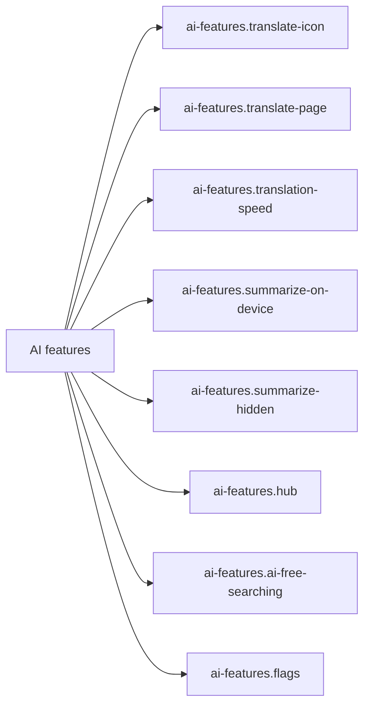

# AI features kept from Firefox

Translations, on-device page summaries and the AI controls hub, which Ecosia keeps (diary 160.md, "Product decisions now in force"). The hub shows only translations and summaries; AI-free searching switches them off.

Covers:
- `firefox-ios/Client/Frontend/Translations/`
- `firefox-ios/Client/Frontend/Summarizer/`
- `firefox-ios/Client/Frontend/UserContent/UserScripts/TranslationsEngine/`
- `firefox-ios/Client/Ecosia/Extensions/Experiments+Ecosia.swift`
- `firefox-ios/nimbus-features/`

## ai-features.translate-icon
p1 · origin MOB-5282 item 1

The translate button in the address bar shows its icon, before and after translating.

**Setup:** fresh install · de

1. Open `https://en.wikipedia.org/wiki/Tree` (AGENT.md: through the `ecosia://open-url` scheme).
2. Wait for the page to load. Screenshot the address bar.
3. Tap the translate button, wait for the German page. Screenshot the address bar again.

**Expect:** the button shows the globe before translating and its active icon after; never an empty tappable space (the active-state asset went missing in 159.1, MOB-5282). Main has translations off, so there is nothing to compare with there.

## ai-features.translate-page
p1 · origin MOB-5035

Translating a page works.

**Setup:** fresh install · de

1. Open `https://en.wikipedia.org/wiki/Tree`, tap the translate button.
2. Choose German if asked; wait up to 60 seconds. Screenshot.
3. Tap the translate button again and show the original.

**Expect:** the article text turns German, then back to English. "Translation timed out" is a fail (diary 160.md, 2026-11-01: the engine page wasn't bundled).

## ai-features.translation-speed
p2 · human: translation speed and model download on a real device

Translation is fast enough on a real device, and the model download works over cellular.

**Setup:** existing · de

1. On an iPhone, translate a long English article.

**Expect:** the first paragraph is translated within a few seconds after the model is downloaded.

## ai-features.summarize-on-device
p1

Summarize a page with the on-device model, on a device that supports it.

**Setup:** existing · en

1. On a simulator or device with Apple Intelligence available, open a long article (`https://en.wikipedia.org/wiki/Tree`).
2. Open the main menu and choose Summarize (or the page action). Screenshot the summary.

**Expect:** a summary appears; nothing mentions a hosted service or a Mozilla account. If the simulator has no on-device model, mark it blocked and check `ai-features.summarize-hidden` instead.

## ai-features.summarize-hidden
p1

Where on-device summaries aren't available, summarizing is hidden entirely.

**Setup:** fresh install · en

1. On a simulator without Apple Intelligence, open an article.
2. Open the main menu and the page actions. Screenshot both.

**Expect:** no Summarize entry anywhere, and no prompt to use a hosted summarizer.

## ai-features.hub
p1

The AI controls hub shows only translations and summaries.

**Setup:** fresh install · de

1. Open Settings and the AI controls (Search section: translation and summary rows). Screenshot.
2. Toggle Translation off, open an English page, check there is no translate button; toggle it back.

**Expect:** only translation and summary controls; no Quick Answers, Lens, chatbot or Firefox AI rows; each switch takes effect.

## ai-features.ai-free-searching
p1 · origin MOB-5035

AI-free searching switches the AI features off, from the app and from the web.

**Setup:** fresh install · en

1. Turn on AI-free searching in Settings (`Settings.aiFreeSearching.switch`).
2. Open an English page on a German device or any article: check translate and summarize entry points.
3. Turn it off on ecosia.org's settings page instead, return to the app's settings.

**Expect:** with AI-free searching on, translate and summarize are gone and the AI overviews switch is off; the web setting and the app switch agree.

## ai-features.flags
p1 · automated: FeatureConfigurationTests/testTranslationsAreOn

The Nimbus configuration keeps translations on and the hosted summarizer off on every channel.

**Setup:** existing · en

1. CI runs `FeatureConfigurationTests`; `verify.sh` runs `check-feature-config.sh` for beta and release.

**Expect:** the tests pass.
