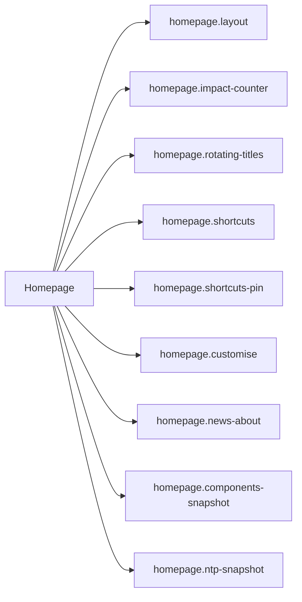

# Homepage

Covers:
- `firefox-ios/Client/Ecosia/Extensions/HomepageViewController+Ecosia.swift`
- `firefox-ios/Client/Ecosia/Extensions/HomepageViewController+EcosiaCells.swift`
- `firefox-ios/Client/Ecosia/Extensions/HomepageViewController+EcosiaContextMenu.swift`
- `firefox-ios/Client/Ecosia/Extensions/HomepageViewController+EcosiaSetup.swift`
- `firefox-ios/Client/Ecosia/Extensions/HomepageDiffableDataSource+EcosiaSnapshot.swift`
- `firefox-ios/Client/Ecosia/Extensions/HomepageSectionLayoutProvider+Ecosia.swift`
- `firefox-ios/Client/Ecosia/UI/NTP/`
- `firefox-ios/Ecosia/UI/NTP/`
- `firefox-ios/Client/Frontend/Home/Homepage/`
- `firefox-ios/Client/Ecosia/Extensions/NumberFormatter+Ecosia.swift`

## homepage.layout
p1 · origin MOB-5282 item 2

The homepage looks like production on the smallest screen: header, headline, impact counters, shortcuts, search bar and toolbar, with nothing cut off or overlapping.

**Setup:** fresh install · de · compare with main

1. Open the app (dismiss onboarding if shown). Screenshot the homepage.
2. Rotate to landscape, screenshot, rotate back.
3. Open a new tab from the toolbar's tab button and screenshot its homepage.

**Expect:** same elements and order as main. The headline is fully visible (at most three lines, two in landscape); counters, shortcuts and the search bar don't overlap and nothing sits behind the toolbar.

## homepage.impact-counter
p1

The impact counters show live totals with their labels and tapping them opens the impact information.

**Setup:** fresh install · de · compare with main

1. Screenshot the counters (`total_trees_count`, `total_invested_count`).
2. Wait 10 seconds and screenshot again.
3. Tap the trees counter. Screenshot what opens, then close it.

**Expect:** both counters show a number with a German label and their icons (`total_trees_image`, `total_invested_image`); the numbers tick up between screenshots; tapping opens the same impact screen as main. Labels that are English on both builds are a production bug, not a regression.

## homepage.rotating-titles
p2 · origin 147 board "NTP → Rotating titles"

The homepage headline rotates through the remote titles.

**Setup:** fresh install · de

1. Screenshot the headline (`ntp_rotating_title`).
2. Open a new tab, screenshot its headline. Repeat twice.

**Expect:** the headline is German and changes between new tabs (or matches the rotation rules on main).

## homepage.shortcuts
p1 · origin 147 board "NTP → Shortcuts"

Shortcuts (top sites) open their site and can be removed.

**Setup:** existing · en

1. Visit three sites so they appear as shortcuts, open a new tab.
2. Tap one shortcut; check the site opens. Go back to a new tab.
3. Long-press a shortcut, choose Remove. Screenshot.

**Expect:** shortcuts show the site icons; tapping opens the site; remove takes it away and it stays removed after opening a new tab.

## homepage.shortcuts-pin
p1 · origin MOB-5037 (pinned badge)

Pinning and unpinning shortcuts.

**Setup:** existing · en · compare with main

1. Long-press a shortcut, choose Pin. Screenshot it.
2. Long-press it again, choose Unpin.

**Expect:** the pinned shortcut shows a pin badge and stays first; unpin removes the badge. The badge is upstream's small template pin icon, an intended change from main's filled badge (see the target file).

## homepage.customise
p1

The customise button opens homepage settings, and turning sections off hides them.

**Setup:** fresh install · en · compare with main

1. Tap the customise button (`ntp_customize_button`). Screenshot.
2. Turn off the impact counter (or "Climate impact") and shortcuts, go back to the homepage. Screenshot.
3. Turn them on again.

**Expect:** the same rows as main; sections disappear when off and come back when on; the homepage has no empty gaps where they were.

## homepage.news-about
p3 · origin template board "NTP → News, About Ecosia"

News and About Ecosia, if the homepage still shows them.

**Setup:** fresh install · en · compare with main

1. Scroll the homepage to the bottom. Screenshot.

**Expect:** the same sections as main. If neither build shows News or About Ecosia, retire this flow.

## homepage.components-snapshot
p1 · automated: HomepageComponentTests

Homepage components (impact cell, shortcuts, header) render like the reference images.

**Setup:** existing · en

1. CI runs the snapshot test.

**Expect:** no difference beyond the tolerance, or only the intended changes listed in the target file.

## homepage.ntp-snapshot
p2 · automated: NTPTests

The whole new-tab page renders like its reference image.

**Setup:** existing · en

1. CI runs the snapshot test (add `NTPTests` to `snapshot_configuration.json`; diary 160.md, MOB-5037 traps).

**Expect:** no difference beyond the tolerance.
