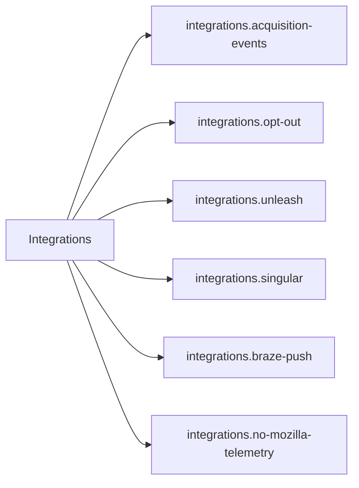

# Analytics and integrations

Snowplow analytics, the tracking opt-out, Singular, Unleash and Braze. The detailed plans live in their Confluence pages and the analytics test plan (147 board links); this file holds the upgrade checks.

Covers:
- `firefox-ios/Ecosia/Analytics/`
- `firefox-ios/Ecosia/Braze/`
- `firefox-ios/Ecosia/FeatureManagement/`
- `firefox-ios/Client/Ecosia/Telemetry/`
- `firefox-ios/Client/Ecosia/Extensions/TelemetryWrapper+Ecosia.swift`
- `firefox-ios/Client/Ecosia/Extensions/GleanUsageReportingMetricsService+Ecosia.swift`
- `firefox-ios/Ecosia/Extensions/DeviceInfo+Ecosia.swift`

## integrations.acquisition-events
p1 · origin template board "Tracking → Acquisition events (install, launch/resume, search)"

Install, launch, resume and search events reach Snowplow.

**Setup:** fresh install · en

1. Run Snowplow Micro locally; launch with `USE_SNOWPLOW_MICRO_INSTANCE`.
2. Complete onboarding; background and resume the app; search once.

**Expect:** install, launch, resume and search events arrive with the same schemas as main. Blocked if Snowplow Micro isn't available.

## integrations.opt-out
p1 · origin 147 board "Tracking → Opt out setting" (MOB-1841)

Turning off analytics in Settings stops events.

**Setup:** existing · en

1. With Snowplow Micro running, turn off the analytics setting; search and navigate.

**Expect:** no events after the switch; the setting persists after a relaunch.

## integrations.unleash
p2 · origin Confluence "Unleash for Napps"

Unleash flags load and apply.

**Setup:** fresh install · en

1. On a debug build, Settings → Debug - Unleash: refresh and read the identifier and flag states.

**Expect:** flags load; the same variants as main for the same identifier.

## integrations.singular
p2 · origin Confluence "Singular → Testing"

Singular sessions are sent as on main.

**Setup:** fresh install · en

1. Follow the Singular testing steps from Confluence against the debug build.

**Expect:** the install and session appear in Singular's test console.

## integrations.braze-push
p2 · human: Braze push needs a real device and the Braze dashboard

Braze in-app messages and push arrive for users in the core region who allowed notifications.

**Setup:** fresh install · de

1. On a device in a core region, allow notifications at first launch; send a test push and an in-app message from Braze.

**Expect:** both arrive. Known production edge case: users who install outside the core region and move into it are never asked for push consent (147 board sticky).

## integrations.no-mozilla-telemetry
p1 · origin MOB-5034

The app sends nothing to Mozilla: no Glean upload, no Nimbus experiments download, no Firefox Suggest download.

**Setup:** fresh install · en

1. Run with a proxy or watch the simulator's network log (diary 160.md, 2026-10-27 for how without a proxy) during launch, a search and five minutes idle.

**Expect:** no requests to `*.mozilla.org`, `*.mozilla.com`, `*.services.mozilla.com` or `firefox.settings.services.mozilla.com` beyond what main makes.
