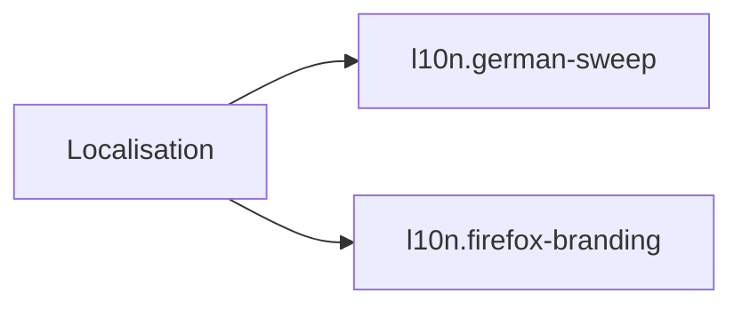

# Localisation

Upgrades bring new Firefox strings and move old ones; Ecosia's strings come from `Ecosia.strings` through Transifex. A German sweep catches English text, Firefox branding and truncation (MOB-5282).

Covers:
- `firefox-ios/Ecosia/L10N/`
- `firefox-ios/Shared/Strings.swift`

## l10n.german-sweep
p1 · origin MOB-5282 items 5–7

Every main screen is German on a German device.

**Setup:** fresh install · de · compare with main

1. Screenshot: onboarding, homepage, main menu (homepage and website), every settings screen one level deep, tab tray, bookmarks, history, downloads, reading list, the address bar's upload drawer ("+" in the search bar), the tracking protection panel.
2. For each English string, check the same screen on main.

**Expect:** no English text that main shows in German. English on both builds is a production gap: note it, it's not a regression.

## l10n.firefox-branding
p1

No "Firefox" or "Mozilla" in user-facing text.

**Setup:** fresh install · en

1. During the sweep above in English, look for "Firefox", "Mozilla", "Pocket", "Fakespot".

**Expect:** none, except legal notices that main also shows.
