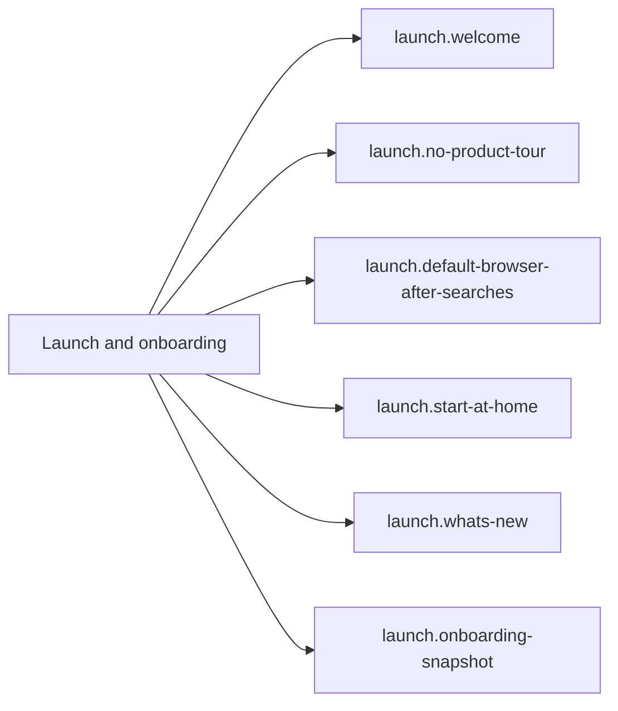

# Launch and onboarding

Covers:
- `firefox-ios/Client/Ecosia/UI/ProductTour/`
- `firefox-ios/Ecosia/UI/ProductTour/`
- `firefox-ios/Client/Ecosia/UI/LaunchScreen/`
- `firefox-ios/Client/Ecosia/UI/StartAtHome/`
- `firefox-ios/Client/Ecosia/UI/NTP/DefaultBrowserViewController.swift`
- `firefox-ios/Client/Ecosia/UI/WhatsNew/`
- `firefox-ios/Ecosia/Extensions/AppInfo+Ecosia.swift`
- `firefox-ios/Client/Frontend/Onboarding/`

## launch.welcome
p1 · origin 147 board "Fresh install → Welcome screen"

A fresh install shows Ecosia's welcome screen, for every user, and leads to the homepage.

**Setup:** fresh install · de · compare with main

1. Launch the app. Screenshot every onboarding screen.
2. Complete onboarding.

**Expect:** Ecosia's welcome screens (no Firefox onboarding, no "Challenge the Default", no Terms of Use sheet that main doesn't show), German text, ending on the homepage with the address bar at the bottom.

## launch.no-product-tour
p2 · origin 147 board "No Product Tour after it"

After the welcome screen there's no product tour: no first-search homepage, no spotlights.

**Setup:** fresh install · en

1. Complete onboarding, then search once and open a new tab.

**Expect:** no tooltips or spotlight overlays beyond what main shows.

## launch.default-browser-after-searches
p2 · origin 147 board "Default Browser Screen"

The default-browser screen appears after the search threshold, once.

**Setup:** fresh install · en

1. Search 50 times (a loop of short queries), opening a new tab between some of them.
2. Screenshot when the default-browser screen appears; dismiss it; search again.

**Expect:** it appears once the threshold is passed and not again after dismissing.

## launch.start-at-home
p2

Start-at-home opens the homepage after the app was in the background long enough.

**Setup:** existing · en

1. Open a website. Settings → Customization → start at home: after four hours (or the shortest option).
2. Background the app, change the simulator clock or wait, reopen.

**Expect:** the homepage after the interval; the website before it.

## launch.whats-new
p3

What's New shows for the new version when main's rules say so.

**Setup:** update from main · en

1. Install main, launch it, then install the upgrade build over it and launch.

**Expect:** the same What's New behaviour as a production update (shown once, or not at all); never Firefox's.

## launch.onboarding-snapshot
p1 · automated: OnboardingTests

The welcome screen renders like its reference images.

**Setup:** existing · en

1. CI runs the snapshot test.

**Expect:** no difference beyond the tolerance.
