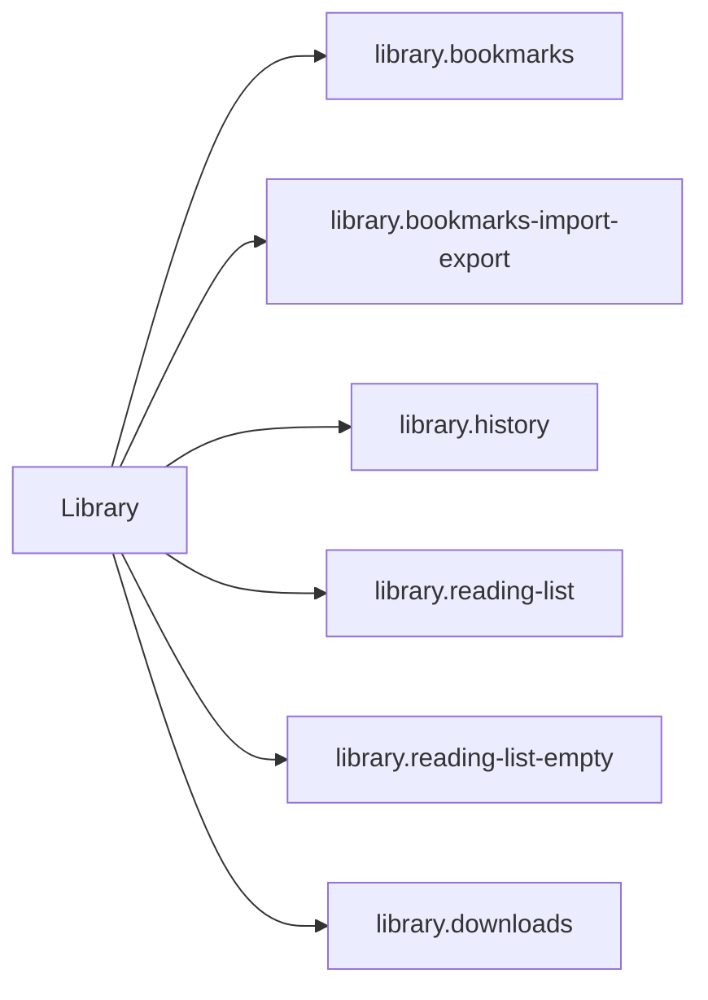

# Library

Bookmarks, history, reading list and downloads.

Covers:
- `firefox-ios/Client/Frontend/Library/`
- `firefox-ios/Client/Ecosia/Bookmarks/`
- `firefox-ios/Client/Ecosia/UI/EmptyBookmarksView.swift`
- `firefox-ios/Client/Ecosia/UI/EmptyReadingListView.swift`
- `firefox-ios/Client/Ecosia/UI/NTP/Library/`
- `firefox-ios/Client/Frontend/Browser/DownloadHelper/`

## library.bookmarks
p1 · origin 147 board "Bookmarks"

Add, open, edit and delete bookmarks; empty state.

**Setup:** fresh install · de · compare with main

1. Open bookmarks from the menu. Screenshot the empty state.
2. Bookmark two pages from the menu; open bookmarks; open one.
3. Edit one's title, create a folder, move a bookmark into it, delete one.

**Expect:** Ecosia's empty state (as main), German text; every action works and persists after a relaunch.

## library.bookmarks-import-export
p2

Bookmarks import from and export to an HTML file.

**Setup:** existing · en

1. Export bookmarks from the bookmarks screen; save to Files.
2. Delete a bookmark, import the exported file.

**Expect:** export produces a file; import restores the bookmark.

## library.history
p1 · origin 147 board "History"

History lists visited pages, searches them and clears them.

**Setup:** existing · en

1. Visit three sites. Open history. Screenshot.
2. Search history for one; delete one entry; clear recent history.

**Expect:** visits listed newest first, grouped by day; search, delete and clear work.

## library.reading-list
p2 · origin 147 board "Reading list"

Pages can be added to and removed from the reading list and open in reader mode.

**Setup:** existing · en

1. Open a Wikipedia article; add it to the reading list from the address bar's reader icon or the menu.
2. Open the reading list, open the item, then remove it.

**Expect:** the reader-mode icon appears on supported pages; the item opens in reader mode; removal works.

## library.reading-list-empty
p3

The empty reading list shows Ecosia's text and icons.

**Setup:** fresh install · de · compare with main

1. Open the reading list. Screenshot.

**Expect:** the same empty state as main, in German.

## library.downloads
p2 · origin 147 board "Downloads"

Files download from page buttons and from the share menu, and are listed.

**Setup:** existing · en

1. Download a PDF from a link (for example a W3C sample PDF).
2. Open a PDF URL, share → Save to Files.
3. Open downloads from the menu.

**Expect:** the download toast appears; the files are listed and open; deleting one works.
