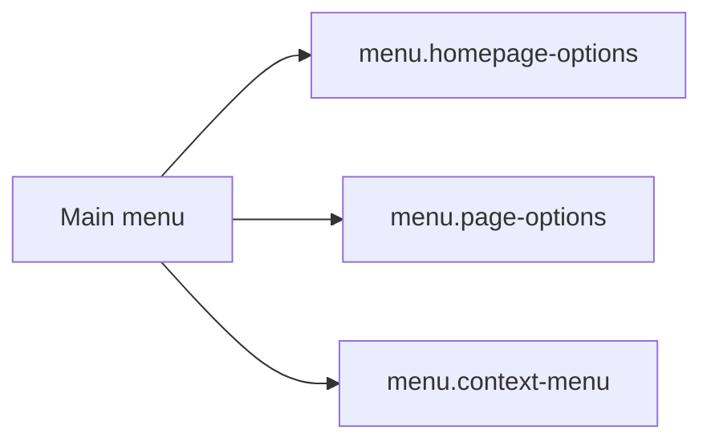

# Main menu

Covers:
- `firefox-ios/Client/Frontend/Browser/MainMenu/`
- `firefox-ios/Client/Ecosia/UI/PageAction/`

## menu.homepage-options
p1 · origin 147 board "App menu options"

The main menu on the homepage has Ecosia's options and each opens the right screen.

**Setup:** fresh install · de · compare with main

1. On the homepage, open the main menu (`…` in the toolbar). Screenshot every page of it.
2. Open each option once and go back.

**Expect:** the same options as main in the same order, German labels, icons on every row; each option opens its screen (bookmarks, history, downloads, reading list, settings, help).

## menu.page-options
p1 · origin 147 board "Reviewed Context Menu"

On a website the menu adapts to the page.

**Setup:** existing · de · compare with main

1. Open `https://en.wikipedia.org/wiki/Tree`, open the main menu. Screenshot every page.
2. Use "find in page" (`FindInPage.searchField`), "add bookmark" and "request desktop site" once.

**Expect:** page actions appear only on a website; labels German; find in page, bookmark and desktop site work; no Summarize entry when on-device summaries aren't available, no Firefox-only entries (Firefox account, Report Broken Site).

## menu.context-menu
p2 · origin 160.1 FXIOS-14918

Long-pressing a link shows the link menu with "Open in Private Tab".

**Setup:** existing · en

1. On a Wikipedia page, long-press a link. Screenshot.
2. Choose "Open in Private Tab".

**Expect:** the menu has open in new tab, open in private tab, copy, share; the link opens in a private tab.
