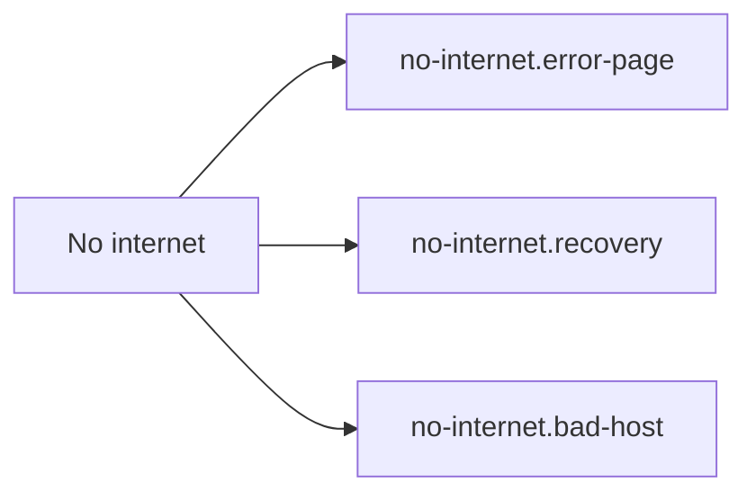

# No internet and error pages

Covers:
- `firefox-ios/Client/Ecosia/Extensions/ErrorPageHandler+Ecosia.swift`
- `firefox-ios/Client/Ecosia/Extensions/BrowserViewController+EcosiaErrorHandling.swift`
- `firefox-ios/Client/Frontend/NativeErrorPage/`
- `firefox-ios/Ecosia/UI/Toast/`

## no-internet.error-page
p1 · origin 147 board "No internet" (MOB-1882)

Without a connection the app shows Ecosia's offline page.

**Setup:** existing · de · network off · compare with main

1. Turn the Mac's network off. Open `https://www.ecosia.org`. Screenshot.
2. Search from the homepage. Screenshot.

**Expect:** the same offline page or toast as main (`error_view_image`), German text, no Firefox branding.

## no-internet.recovery
p2

Reconnecting recovers.

**Setup:** existing · en · network off

1. With the offline page showing, turn the network on and reload.

**Expect:** the page loads.

## no-internet.bad-host
p2

A host that doesn't exist shows the error page, not a blank tab.

**Setup:** existing · en · compare with main

1. Open `https://ecosia.invalid`. Screenshot.

**Expect:** the same error page as main.
