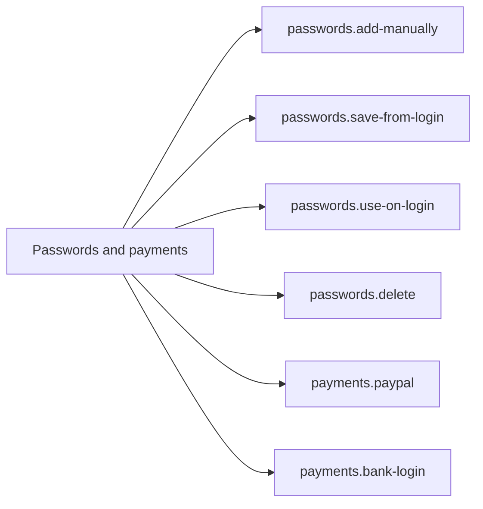

# Passwords and payments

Covers:
- `firefox-ios/Client/Frontend/PasswordManagement/`
- `firefox-ios/Client/Frontend/Autofill/`
- `firefox-ios/Storage/Rust/RustLogins+EcosiaMigration.swift`

## passwords.add-manually
p2 · origin 147 board "Passwords → Add password"

Add a password from the passwords screen.

**Setup:** existing · en

1. Settings → Passwords (approve the passcode prompt on the simulator: Features → Face ID → Matching Face, or `xcrun simctl spawn <udid> notifyutil -p com.apple.BiometricKit_Sim.pearl.match`).
2. Add a login for `https://example.com` with a made-up username and password. Screenshot the list.

**Expect:** the login is listed and can be opened, revealed and copied.

## passwords.save-from-login
p2 · origin 147 board "Passwords → via tooltip"

Submitting a login form offers to save the password.

**Setup:** existing · en

1. Open a public test login form (for example `https://the-internet.herokuapp.com/login`), fill it with the form's published demo values, submit.
2. Screenshot the save prompt; save.

**Expect:** the app offers to save; the login appears in Passwords.

## passwords.use-on-login
p2

Saved logins fill a login form.

**Setup:** existing · en

1. Return to the login form from the previous flow; tap the username field. Screenshot the suggestion.
2. Choose the saved login.

**Expect:** the saved login is offered and fills both fields.

## passwords.delete
p3

Deleting a saved password.

**Setup:** existing · en

1. Settings → Passwords, delete the test login.

**Expect:** it's gone and isn't offered on the form any more.

## payments.paypal
p2 · origin 147 board "Payments → PayPal"

PayPal checkout opens the PayPal pop-up.

**Setup:** existing · en

1. Open a page with a PayPal button (PayPal's public checkout demo).
2. Tap the PayPal button. Screenshot.

**Expect:** the PayPal window or pop-up opens (a new tab or sheet with paypal.com). Logging in and paying is not needed.

## payments.bank-login
p3 · origin 147 board "Payments → bank accounts"

Bank login pages and pop-ups open.

**Setup:** existing · en

1. Open a bank's public online-banking login page that uses a pop-up or redirect.

**Expect:** the login page or pop-up opens and is usable. Don't enter anything.
