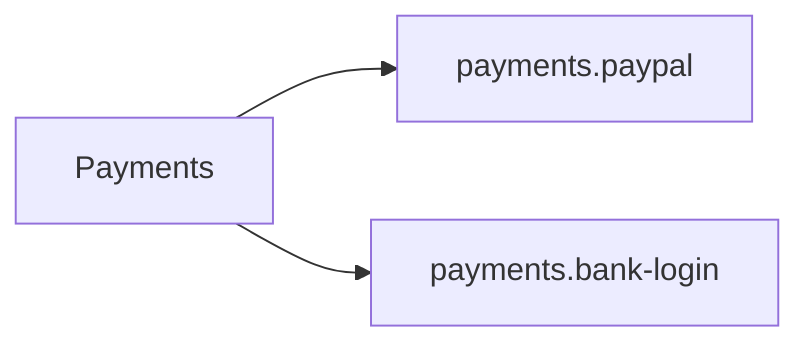

# Payments

Payment pages and pop-ups inside the browser. Opening the provider's window is enough; no real payment.

Covers:
- `firefox-ios/Client/Ecosia/Extensions/BrowserViewController+EcosiaNavigationHandling.swift`

## payments.paypal
p2 · origin 147 board "Payments → PayPal"

PayPal checkout opens the PayPal pop-up.

**Setup:** existing · en

1. Open a page with a PayPal button (PayPal's public checkout demo).
2. Tap the PayPal button. Screenshot.

**Expect:** the PayPal window or pop-up opens (a new tab or sheet with paypal.com). Logging in and paying is not needed.

## payments.bank-login
p3 · origin 147 board "Payments → bank accounts"

Bank login pages and pop-ups open.

**Setup:** existing · en

1. Open a bank's public online-banking login page that uses a pop-up or redirect.

**Expect:** the login page or pop-up opens and is usable. Don't enter anything.
