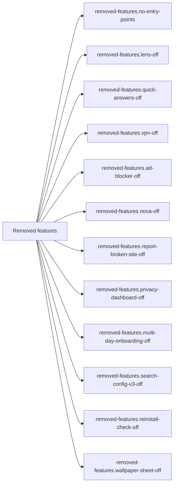

# Removed Firefox features

Firefox features Ecosia turns off must have no entry point anywhere in the app (diary 160.md, "Product decisions now in force"; inventory 160.1 for the wallpaper sheet and the reinstall check).

Covers:
- `firefox-ios/Client/FeatureFlags/`
- `firefox-ios/nimbus-features/`
- `firefox-ios/Client/Frontend/Browser/MainMenu/MainMenuConfigurationUtility.swift`

## removed-features.no-entry-points
p1

No visible entry point for Google Lens, Quick Answers (voice), VPN, the ad blocker, Firefox's wallpaper engagement sheet or the privacy dashboard.

**Setup:** fresh install · en

1. Homepage: screenshot; long-press the search bar and the address bar.
2. Focus the address bar: screenshot the keyboard accessory and suggestions (no camera/Lens or microphone/Quick Answers button).
3. Open a page: screenshot the address bar (no ad blocker or shield badge beyond tracking protection), open the main menu and screenshot every page of it.
4. Settings: scroll through every section.
5. Open five new tabs in a row (the wallpaper sheet would appear on the homepage).

**Expect:** none of these features appear anywhere, and no sheet or tooltip promotes them. Ads on Ecosia's search results are visible (the ad blocker would hide them).

## removed-features.lens-off
p1 · automated: FeatureConfigurationTests/testGoogleLensIsOff

Google Lens is off on every channel.

**Setup:** existing · en

1. CI runs the test.

**Expect:** it passes.

## removed-features.quick-answers-off
p1 · automated: FeatureConfigurationTests/testQuickAnswersAreOff

Quick Answers is off on every channel, including 160.1's follow-up questions and opt-in redesign.

**Setup:** existing · en

1. CI runs the test.

**Expect:** it passes.

## removed-features.vpn-off
p1 · automated: FeatureConfigurationTests/testVPNIsOff

The VPN promotion, settings row and error page are off.

**Setup:** existing · en

1. CI runs the test.

**Expect:** it passes.

## removed-features.ad-blocker-off
p1 · automated: FeatureConfigurationTests/testAdBlockerAndItsBadgeAreOff

The ad blocker and its badge are off, so Ecosia's ads stay visible.

**Setup:** existing · en

1. CI runs the test.

**Expect:** it passes.

## removed-features.nova-off
p2 · automated: FeatureConfigurationTests/testNovaDesignIsOff

Firefox's Nova redesign stays off.

**Setup:** existing · en

1. CI runs the test.

**Expect:** it passes.

## removed-features.report-broken-site-off
p2 · automated: FeatureConfigurationTests/testReportBrokenSiteIsOff

Firefox's Report Broken Site is off on every channel.

**Setup:** existing · en

1. CI runs the test; `check-feature-config.sh` checks beta and release.

**Expect:** it passes.

## removed-features.privacy-dashboard-off
p2 · automated: FeatureConfigurationTests/testPrivacyDashboardIsOff

Firefox's homepage privacy dashboard is off on every channel.

**Setup:** existing · en

1. CI runs the test; `check-feature-config.sh` checks beta and release.

**Expect:** it passes.

## removed-features.multi-day-onboarding-off
p2 · automated: FeatureConfigurationTests/testMultiDayOnboardingIsOff

Firefox's multi-day onboarding is off on every channel.

**Setup:** existing · en

1. CI runs the test; `check-feature-config.sh` checks beta and release.

**Expect:** it passes.

## removed-features.search-config-v3-off
p1 · automated: FeatureConfigurationTests/testSearchConfigV3IsOff

Search config v3 is off, so only Ecosia's code chooses the default engine (inventory 160.1).

**Setup:** existing · en

1. CI runs the test; `check-feature-config.sh` checks beta and release.

**Expect:** it passes.

## removed-features.reinstall-check-off
p2 · automated: FeatureConfigurationTests/testCheckForReinstallsIsOff

Firefox's reinstall check (160.1) is off: no install telemetry to Mozilla.

**Setup:** existing · en

1. CI runs the test; `check-feature-config.sh` checks beta and release.

**Expect:** it passes.

## removed-features.wallpaper-sheet-off
p2 · automated: FeatureConfigurationTests/testWallpaperEngagementSheetIsOff

Firefox's wallpaper engagement sheet (160.1) is off.

**Setup:** existing · en

1. CI runs the test; `check-feature-config.sh` checks beta and release.

**Expect:** it passes.
