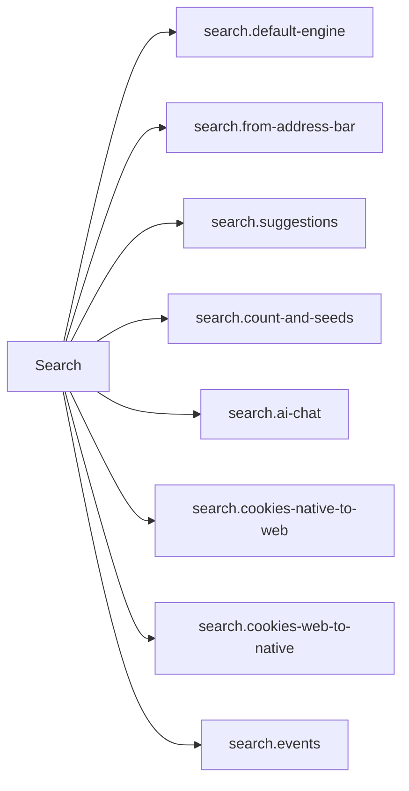

# Search

Search engine, search from every entry point, search counting, AI search modes, and settings shared with ecosia.org through cookies.

Covers:
- `firefox-ios/Client/Ecosia/Search/`
- `firefox-ios/Ecosia/Search/`
- `firefox-ios/Client/Ecosia/Extensions/SearchViewController+Ecosia.swift`
- `firefox-ios/Client/Ecosia/Extensions/BrowserViewController+EcosiaNavigationHandling.swift`
- `firefox-ios/Client/Frontend/Browser/SearchEngines/`
- `firefox-ios/Client/Frontend/Browser/Search/`
- `firefox-ios/Client/Ecosia/Web/`

## search.default-engine
p1

Ecosia is the default search engine and the engine picker lists Ecosia's providers.

**Setup:** fresh install · de · compare with main

1. Settings → Search → default search engine (`Settings.Search.defaultSearchEngine`). Screenshot.
2. Go back without changing it.

**Expect:** Ecosia is selected; the list matches main. Firefox's search config v3 must not change the default (inventory 160.1).

## search.from-address-bar
p1

Searching from the homepage search bar and from the address bar opens Ecosia's results.

**Setup:** fresh install · de

1. From the homepage search bar, search "Bäume pflanzen". Screenshot.
2. From the address bar on a website, search "trees". Screenshot.

**Expect:** both open `ecosia.org/search` results in the same tab, in German for the first.

## search.suggestions
p2

Search suggestions appear while typing and can be turned off.

**Setup:** fresh install · en

1. Type "tree" in the address bar. Screenshot the suggestions (`searchSuggestion` rows, the AI chat row `searchSuggestion_aiChat` if present).
2. Turn off search suggestions in Settings and type again.

**Expect:** suggestions from Ecosia appear and tapping one searches it; none after turning them off. No Firefox Suggest results.

## search.count-and-seeds
p1 · origin 147 board "Cookies → Search count"

Searches are counted: the seed counter in the header grows.

**Setup:** fresh install · en

1. Screenshot the seed counter (`seed_count_view`) on the homepage.
2. Search three different terms, return to a new tab. Screenshot.

**Expect:** the counter went up after the searches (by the same rule as main).

## search.ai-chat
p2

AI search modes open from the omnibox when available.

**Setup:** fresh install · en · compare with main

1. Focus the address bar, type a question, check for the AI chat suggestion or mode switch. Screenshot.
2. Choose it.

**Expect:** the same entry points as main; the chat opens on Ecosia. With AI-free searching on, none.

## search.cookies-native-to-web
p1 · origin template board "Cookies → infos synced between web and native"

Settings changed in the app reach ecosia.org: search region, safe search, AI overviews.

**Setup:** fresh install · en

1. In the app's Settings, change search region, safe search, and AI overviews.
2. Search "test", open ecosia.org's settings page in the same app. Screenshot.

**Expect:** the web settings show the values chosen in the app.

## search.cookies-web-to-native
p1 · origin template board "Cookies → infos synced between web and native"

Settings changed on ecosia.org reach the app: search region, safe search, autocomplete, cookie consent, search count.

**Setup:** fresh install · en

1. On ecosia.org's settings page inside the app, change region, safe search and autocomplete, and answer the cookie consent.
2. Open the app's Settings. Screenshot.

**Expect:** the app's Settings show the web values; the consent isn't asked again in the app.

## search.events
p2 · origin 147 board "Tracking → Acquisition events → Search"

Search events reach analytics.

**Setup:** fresh install · en

1. Launch with Snowplow Micro (`xcrun simctl launch <udid> com.ecosia.ecosiaapp USE_SNOWPLOW_MICRO_INSTANCE` (`LaunchArguments.UseSnowplowMicroInstance`), Snowplow Micro running locally).
2. Search twice.

**Expect:** search events appear in Snowplow Micro with the same schema as main. If Snowplow Micro isn't available, mark blocked.
