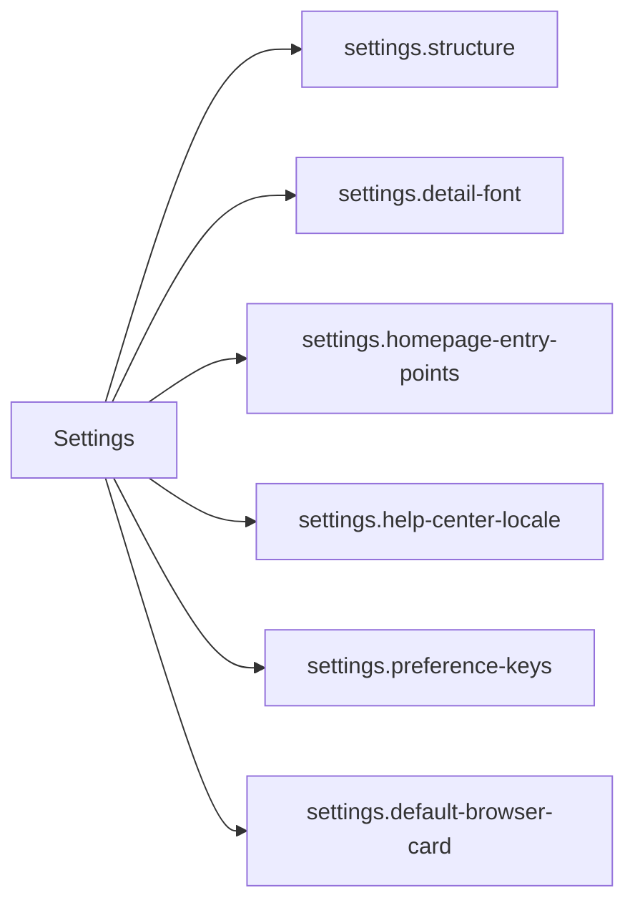

# Settings

Covers:
- `firefox-ios/Client/Frontend/Settings/Main/AppSettingsTableViewController.swift`
- `firefox-ios/Client/Ecosia/Extensions/AppSettingsTableViewController+Ecosia.swift`
- `firefox-ios/Client/Ecosia/Extensions/PrefsKeys+Ecosia.swift`
- `firefox-ios/Client/Coordinators/SettingsCoordinator.swift`
- `firefox-ios/Client/Frontend/Settings/HomepageSettings/HomePageSettingViewController.swift`
- `firefox-ios/Client/Ecosia/Settings/`

## settings.structure
p1

The settings screen has Ecosia's sections and rows, in production's order, and nothing from Firefox that Ecosia hides.

**Setup:** fresh install · de · compare with main

1. Open the main menu, then Settings. Screenshot.
2. Scroll to the bottom, taking a screenshot per screen.
3. Open each row in the Search and Customization sections once and go back.

**Expect:** the same sections and rows as main, in the same order. No Firefox Account, Firefox Suggest, VPN, ad blocker, Nova or "Firefox" wording. Every row opens a screen and back returns to settings.

## settings.detail-font
p1 · origin MOB-5282 item 3

Detail values on the right of settings rows (for example the search engine, "Automatisch") use the same font size as production.

**Setup:** fresh install · de · compare with main

1. Open Settings. Screenshot the first screen.
2. Open Search, screenshot; open Customization rows with a value on the right, screenshot.

**Expect:** detail text has the same size and colour as main; no row's detail is visibly smaller. Upstream 159.1 made it caption-size (FXIOS-17151); 160.0's FXIOS-17242 limits that to switch rows.

## settings.homepage-entry-points
p1 · origin MOB-5282 item 4

Homepage settings are the same screen from every entry point.

**Setup:** fresh install · de · compare with main

1. Open the main menu, then Settings, then Homepage. Screenshot.
2. Go back to the homepage and tap the customise button (`ntp_customize_button`). Screenshot.
3. Long-press the impact counter or a homepage section if it offers settings. Screenshot.

**Expect:** every entry point opens the same screen, with the same rows in the same order, matching main's settings entry point.

## settings.help-center-locale
p1 · origin MOB-5282 item 6

Help links open Ecosia's Help Center in the device language.

**Setup:** fresh install · de

1. Open Settings, then the Help Center (or "Hilfe") row.
2. Screenshot the page that opens, including the address bar.

**Expect:** the Help Center page is German (URL with the `de` locale or a German page); not the English one.

## settings.preference-keys
p1 · origin Confluence Firefox Upgrades step 6.4

Settings that Ecosia stores under Firefox's preference keys keep working after upstream changed or renamed keys.

**Setup:** existing · en

1. Toggle each switch in Settings (search suggestions, AI overviews `Settings.aiOverviews.switch`, AI-free searching `Settings.aiFreeSearching.switch`, close private tabs, start at home and the others present).
2. Kill the app (swipe it away in the app switcher), launch it again, open Settings.

**Expect:** every switch kept its value after the relaunch, and its effect applies (for example search suggestions stop appearing when turned off).

## settings.default-browser-card
p2

The default-browser nudge card in settings shows and hides like production.

**Setup:** fresh install · en · compare with main

1. Open Settings. Screenshot the top.
2. If a default-browser card is shown, dismiss it, leave Settings and open it again.

**Expect:** the card appears on the same condition as main and stays dismissed after dismissing it.
