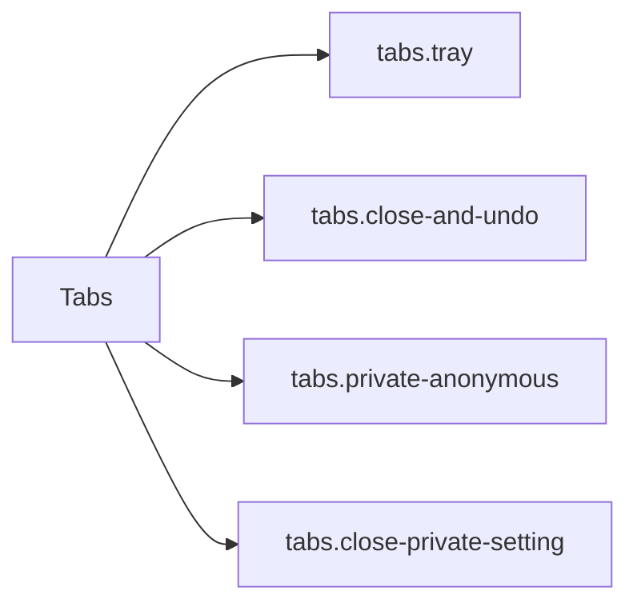

# Tabs and private tabs

Covers:
- `firefox-ios/Client/Frontend/Browser/Tabs/`
- `firefox-ios/Client/TabManagement/`
- `firefox-ios/Client/Ecosia/Extensions/Tab+Ecosia.swift`
- `firefox-ios/Client/Ecosia/Extensions/SimpleToast+Ecosia.swift`

## tabs.tray
p1 · origin 147 board "Tabs", "New Tab Manager layout"

The tab tray shows, opens and switches tabs with Ecosia's styling.

**Setup:** existing · de · compare with main

1. Open four tabs on different sites. Open the tab tray. Screenshot.
2. Switch to another tab from the tray; open a new tab from the tray.

**Expect:** the same layout as main (grid, thumbnails, titles, counters), new-tab thumbnails show Ecosia's globe; switching and opening work.

## tabs.close-and-undo
p2

Closing tabs, closing all, and undo.

**Setup:** existing · en

1. Close one tab from the tray; undo from the toast.
2. Close all tabs.

**Expect:** undo restores the tab; close all leaves one new tab on the homepage.

## tabs.private-anonymous
p1 · origin 147 board "Private tabs"

Private tabs leave no history and don't count searches.

**Setup:** existing · en

1. Switch to private mode in the tab tray. Screenshot (private theme).
2. Search "secret", visit a site.
3. Leave private mode, open history.

**Expect:** private styling as main; nothing from the private session in history; the seed counter did not change.

## tabs.close-private-setting
p2 · origin 147 board "Close Private Tabs"

"Close private tabs" decides whether private tabs survive leaving private mode or a relaunch.

**Setup:** existing · en

1. With the setting off, open a private tab, relaunch, check private tabs.
2. Turn it on, open a private tab, relaunch, check again.

**Expect:** off: the private tab is still there; on: it's gone.
