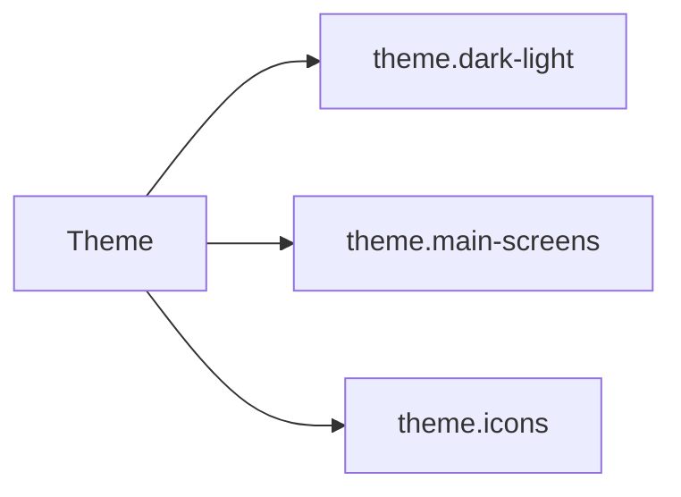

# Theme

Covers:
- `firefox-ios/Client/Ecosia/UI/Theme/`
- `firefox-ios/Ecosia/UI/Extensions/Color+Ecosia.swift`
- `firefox-ios/Ecosia/UI/DesignSystem/`
- `firefox-ios/Client/Ecosia/Extensions/UIFont+Ecosia.swift`
- `firefox-ios/Client/Ecosia/UI/Font/`
- `firefox-ios/Ecosia/Extensions/UIImage+Ecosia.swift`

## theme.dark-light
p1 · origin 147 board "Ecosia Theme"

The app follows the system's dark and light mode.

**Setup:** existing · en · compare with main

1. Homepage and a website in light mode: screenshot.
2. Switch the simulator to dark (`xcrun simctl ui <udid> appearance dark`): screenshot the same screens.

**Expect:** both modes use Ecosia's colours as on main; no Firefox purple, no unreadable text.

## theme.main-screens
p1 · origin 147 board "Main app screens have correct theme"

Homepage, tab tray, settings, menus and toolbars use Ecosia's theme in both modes.

**Setup:** existing · de · compare with main

1. In light and in dark mode, screenshot: homepage, tab tray, settings, main menu, toolbar on a website.

**Expect:** matches main in both modes.

## theme.icons
p2 · origin inventory 160.1 (Acorn icons), MOB-5282 item 1

No missing images: every button and row shows an icon where main does.

**Setup:** existing · de · compare with main

1. While running the other flows, compare every toolbar, menu and settings icon with main.

**Expect:** no empty space where main has an icon. Upstream's refreshed icons are fine where Ecosia doesn't replace them.
