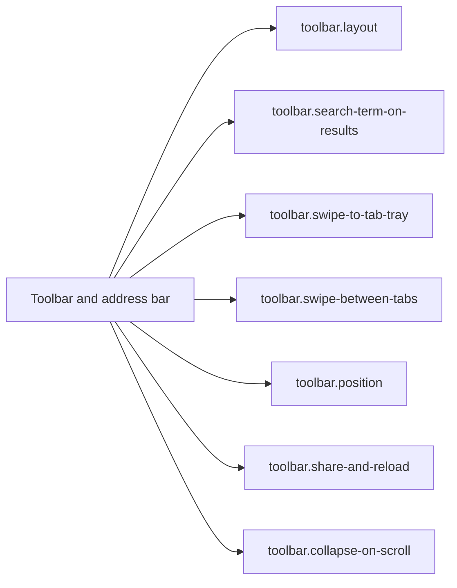

# Toolbar and address bar

Covers:
- `firefox-ios/Client/Frontend/Browser/Toolbars/`
- `firefox-ios/Client/Ecosia/Toolbars/`
- `firefox-ios/Client/Ecosia/Extensions/BrowserViewController+Ecosia.swift`
- `firefox-ios/Client/Ecosia/Extensions/BrowserCoordinator+Ecosia.swift`
- `firefox-ios/Client/Ecosia/Extensions/URL+Ecosia.swift`
- `firefox-ios/Client/Ecosia/UI/NTP/SearchBar/`
- `BrowserKit/Sources/ToolbarKit/`

## toolbar.layout
p1 · origin inventory 159.1 (toolbar tab icon enhancement)

The toolbar and address bar have Ecosia's buttons, icons and order.

**Setup:** fresh install · de · compare with main

1. Homepage: screenshot the toolbar.
2. Open `https://www.ecosia.org`: screenshot the address bar and toolbar.
3. Focus the address bar: screenshot.

**Expect:** the same buttons in the same order as main (back, forward, history or new tab, tabs count, menu), every button has its icon, the tab counter shows the right number. Upstream's Acorn icon refresh is fine where Ecosia doesn't replace the icon.

## toolbar.search-term-on-results
p1

On Ecosia's results page the address bar shows the search term, not the URL.

**Setup:** fresh install · en · compare with main

1. Search "tree planting" from the homepage. Screenshot the address bar.
2. Tap the address bar. Screenshot.

**Expect:** the address bar shows "tree planting"; editing starts from the term.

## toolbar.swipe-to-tab-tray
p1 · origin MOB-5042 (decision 2026-11-17)

Swiping up on the address bar opens the tab tray.

**Setup:** existing · en

1. Open two tabs. Swipe up from the address bar.
2. Screenshot what opens. Close it.

**Expect:** the tab tray opens with a preview of the new tab that shows Ecosia's globe, not Firefox's logo.

## toolbar.swipe-between-tabs
p2 · origin 147 board "New Firefox features are adjusted → Swiping between tabs"

Swiping sideways on the address bar switches tabs.

**Setup:** existing · en

1. Open three tabs with different sites. Swipe left and right on the address bar.

**Expect:** each swipe moves to the next or previous tab with the page and address bar in sync; no empty or Firefox-branded preview.

## toolbar.position
p1 · origin 147 board "Bottom bar settings"

Address bar position: bottom by default, top when chosen.

**Setup:** fresh install · en

1. Screenshot: the address bar is at the bottom.
2. Settings → Customization → address bar position: top. Go back and screenshot.

**Expect:** bottom on a fresh install; top after the change, and it stays after a relaunch.

## toolbar.share-and-reload
p2 · origin MOB-5038 (share icon)

The address bar's share and reload actions work.

**Setup:** existing · en

1. Open a page, tap the share button. Screenshot the share sheet, close it.
2. Reload the page from the address bar.

**Expect:** the share icon is the Apple share icon; the share sheet opens with the page URL; reload reloads.

## toolbar.collapse-on-scroll
p2 · origin 147 board comment (collapsed bar on results)

Scrolling a page collapses the toolbar and scrolling up brings it back.

**Setup:** existing · en · compare with main

1. Search "trees", scroll down the results. Screenshot.
2. Scroll up. Screenshot.

**Expect:** the toolbar collapses and returns like on main; results page content stays readable above the collapsed bar.
