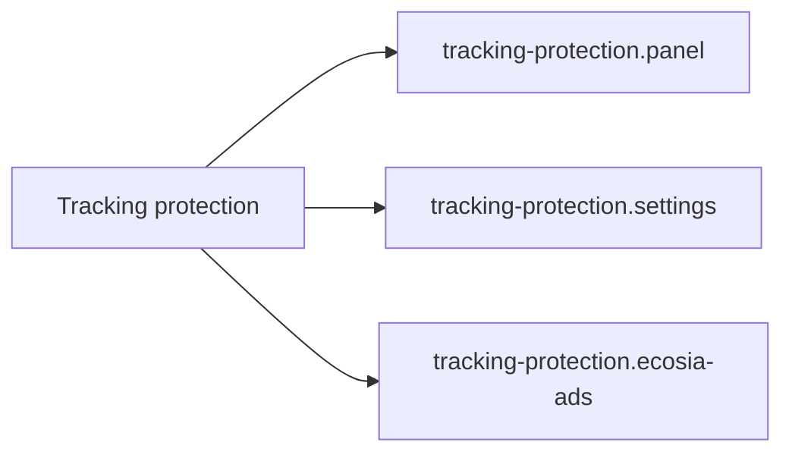

# Tracking protection

Covers:
- `firefox-ios/Client/Frontend/TrackingProtection/`
- `firefox-ios/Client/Frontend/Browser/FirefoxTabContentBlocker.swift`

## tracking-protection.panel
p1

The shield in the address bar opens the tracking protection panel for the site.

**Setup:** existing · de · compare with main

1. Open a news site with trackers. Tap the shield/lock in the address bar. Screenshot.
2. Turn protection off for the site, reload, turn it on again.

**Expect:** the same panel as main (blocked trackers, connection security), German text, no Firefox branding; the per-site switch works.

## tracking-protection.settings
p1

Standard and strict protection settings persist.

**Setup:** existing · en

1. Settings → tracking protection. Screenshot. Switch to strict, relaunch, check.

**Expect:** the same options as main; the choice persists.

## tracking-protection.ecosia-ads
p1 · origin diary 160.md (ad blocker out)

Ecosia's search ads are not blocked.

**Setup:** fresh install · en

1. Search "running shoes". Screenshot the top of the results. Don't tap an ad (diary 160.md, 2026-11-01 traps).

**Expect:** ads show on the results, as on main, in both standard and strict protection.
