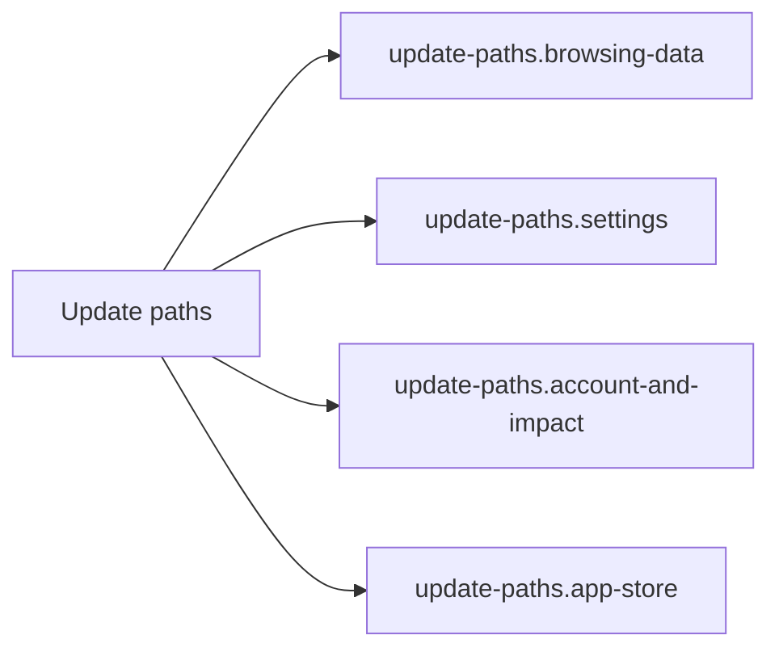

# Update paths

Users updating from production keep their data and settings (MOB-5046). On the simulator: install a `main` build, create the state, install the upgrade build over it; the data container survives as on an App Store update. Migrations specific to one upgrade go in its target file.

Covers:
- `firefox-ios/Client/Ecosia/Extensions/PrefsKeys+Ecosia.swift`
- `firefox-ios/Storage/Rust/RustLogins+EcosiaMigration.swift`
- `firefox-ios/Storage/RustKeychain+Ecosia.swift`
- `firefox-ios/Client/Ecosia/RecoveredFromUpgrade/`
- `firefox-ios/Client/Application/`

## update-paths.browsing-data
p1 · origin 147 board "Upgrade from earlier version → Stored infos are fully persisted"

Tabs (normal and private), history, bookmarks, reading list, shortcuts (top sites and pinned) and passwords survive the update.

**Setup:** update from main · en

1. On the main build: open five tabs and two private tabs (with "close private tabs" off), visit sites, add two bookmarks in a folder, add a reading-list item, pin a shortcut, remove another, save a password. Screenshot tab tray, bookmarks, history, homepage.
2. Install the upgrade build over it, launch. Screenshot the same screens.

**Expect:** everything is still there, in the same order; the selected tab is the same; pinned and removed shortcuts kept their state.

## update-paths.settings
p1 · origin template board "Upgrade from earlier version → Settings"

Settings survive the update: search engine, search region, safe search, AI overviews, AI-free searching, address bar position, start at home, theme, tracking protection, close private tabs, analytics opt-out.

**Setup:** update from main · en

1. On the main build, change each of those settings away from its default. Screenshot Settings.
2. Install the upgrade build over it, launch, open Settings. Screenshot.

**Expect:** every value is unchanged.

## update-paths.account-and-impact
p1

The signed-in account, seed count and impact survive the update.

**Setup:** update from main · en · signed in as "iOS QA staging 1" (beta build)

1. On the main beta build: sign in, search five times. Screenshot the header.
2. Install the upgrade beta build over it, launch.

**Expect:** still signed in, same avatar and seed count (or higher), no sign-in prompt, no extra tab.

## update-paths.app-store
p1 · human: App Store update to a TestFlight build needs a real device

The real update from the App Store version to the TestFlight build.

**Setup:** update from main · en

1. On a device with the current App Store version and realistic data, install the TestFlight build.
2. Repeat the checks of the three flows above.

**Expect:** the same results as on the simulator.
