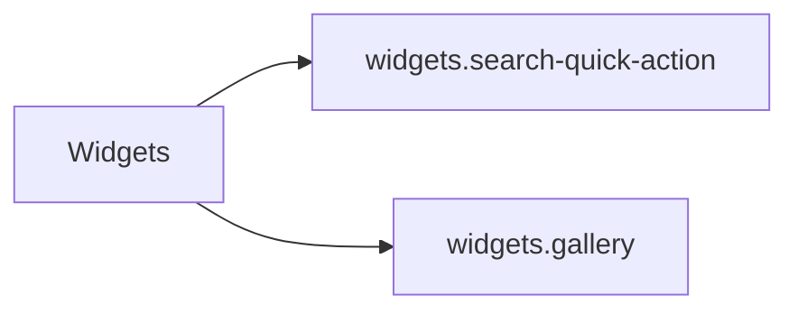

# Widgets

Covers:
- `firefox-ios/WidgetKit/`
- `firefox-ios/Ecosia/UI/WidgetKitAssets.xcassets/`

## widgets.search-quick-action
p1 · origin 147 board "Widgets"

The "search in Ecosia" quick action widget can be added and opens a search.

**Setup:** existing · de · compare with main

1. Go to the home screen (swipe up from the bottom edge). Long-press an empty area → Edit → Add Widget → search "Ecosia" → "Schnellaktionen" (quick actions) → Add Widget.
2. Tap Done, then tap the widget. Screenshot the app.

**Expect:** the widget shows "In Ecosia suchen" with Ecosia's logo; tapping it opens a new tab ready to search, as on main.

## widgets.gallery
p2

Every Ecosia widget in the gallery is branded and translated.

**Setup:** existing · de · compare with main

1. Open the widget gallery for Ecosia and swipe through every widget. Screenshot each.

**Expect:** the same widgets as main, Ecosia's names, icons and German text; no Firefox widget.
