# Test plan map

Generated by `tools/test_plan.py --map` from `areas/` and `targets/`; don't edit by hand.

107 flows: 89 agent · 15 automated · 3 human.

```mermaid
flowchart LR
  classDef agent fill:#e3f2e1,stroke:#2e7d32,color:#1b5e20
  classDef automated fill:#e3ecfa,stroke:#1565c0,color:#0d47a1
  classDef human fill:#fdecea,stroke:#c62828,color:#b71c1c
  plan((Upgrade test plan))
  plan --> area_accounts["Accounts"]
  area_accounts --> accounts_sign_in["accounts.sign-in"]:::agent
  area_accounts --> accounts_invisible_tab["accounts.invisible-tab"]:::agent
  area_accounts --> accounts_web_session["accounts.web-session"]:::agent
  area_accounts --> accounts_sign_out["accounts.sign-out"]:::agent
  area_accounts --> accounts_signed_out_header["accounts.signed-out-header"]:::agent
  plan --> area_ai_features["AI features kept from Firefox"]
  area_ai_features --> ai_features_translate_icon["ai-features.translate-icon"]:::agent
  area_ai_features --> ai_features_translate_page["ai-features.translate-page"]:::agent
  area_ai_features --> ai_features_translation_speed["ai-features.translation-speed"]:::human
  area_ai_features --> ai_features_summarize_on_device["ai-features.summarize-on-device"]:::agent
  area_ai_features --> ai_features_summarize_hidden["ai-features.summarize-hidden"]:::agent
  area_ai_features --> ai_features_hub["ai-features.hub"]:::agent
  area_ai_features --> ai_features_ai_free_searching["ai-features.ai-free-searching"]:::agent
  area_ai_features --> ai_features_flags["ai-features.flags"]:::automated
  plan --> area_homepage["Homepage"]
  area_homepage --> homepage_layout["homepage.layout"]:::agent
  area_homepage --> homepage_impact_counter["homepage.impact-counter"]:::agent
  area_homepage --> homepage_rotating_titles["homepage.rotating-titles"]:::agent
  area_homepage --> homepage_shortcuts["homepage.shortcuts"]:::agent
  area_homepage --> homepage_shortcuts_pin["homepage.shortcuts-pin"]:::agent
  area_homepage --> homepage_customise["homepage.customise"]:::agent
  area_homepage --> homepage_news_about["homepage.news-about"]:::agent
  area_homepage --> homepage_components_snapshot["homepage.components-snapshot"]:::automated
  area_homepage --> homepage_ntp_snapshot["homepage.ntp-snapshot"]:::automated
  plan --> area_integrations["Analytics and integrations"]
  area_integrations --> integrations_acquisition_events["integrations.acquisition-events"]:::agent
  area_integrations --> integrations_opt_out["integrations.opt-out"]:::agent
  area_integrations --> integrations_unleash["integrations.unleash"]:::agent
  area_integrations --> integrations_singular["integrations.singular"]:::agent
  area_integrations --> integrations_braze_push["integrations.braze-push"]:::human
  area_integrations --> integrations_no_mozilla_telemetry["integrations.no-mozilla-telemetry"]:::agent
  plan --> area_l10n["Localisation"]
  area_l10n --> l10n_german_sweep["l10n.german-sweep"]:::agent
  area_l10n --> l10n_firefox_branding["l10n.firefox-branding"]:::agent
  plan --> area_launch["Launch and onboarding"]
  area_launch --> launch_welcome["launch.welcome"]:::agent
  area_launch --> launch_no_product_tour["launch.no-product-tour"]:::agent
  area_launch --> launch_default_browser_after_searches["launch.default-browser-after-searches"]:::agent
  area_launch --> launch_start_at_home["launch.start-at-home"]:::agent
  area_launch --> launch_whats_new["launch.whats-new"]:::agent
  area_launch --> launch_onboarding_snapshot["launch.onboarding-snapshot"]:::automated
  plan --> area_library["Library"]
  area_library --> library_bookmarks["library.bookmarks"]:::agent
  area_library --> library_bookmarks_import_export["library.bookmarks-import-export"]:::agent
  area_library --> library_history["library.history"]:::agent
  area_library --> library_reading_list["library.reading-list"]:::agent
  area_library --> library_reading_list_empty["library.reading-list-empty"]:::agent
  area_library --> library_downloads["library.downloads"]:::agent
  plan --> area_menu["Main menu"]
  area_menu --> menu_homepage_options["menu.homepage-options"]:::agent
  area_menu --> menu_page_options["menu.page-options"]:::agent
  area_menu --> menu_context_menu["menu.context-menu"]:::agent
  plan --> area_no_internet["No internet and error pages"]
  area_no_internet --> no_internet_error_page["no-internet.error-page"]:::agent
  area_no_internet --> no_internet_recovery["no-internet.recovery"]:::agent
  area_no_internet --> no_internet_bad_host["no-internet.bad-host"]:::agent
  plan --> area_passwords_and_payments["Passwords and payments"]
  area_passwords_and_payments --> passwords_add_manually["passwords.add-manually"]:::agent
  area_passwords_and_payments --> passwords_save_from_login["passwords.save-from-login"]:::agent
  area_passwords_and_payments --> passwords_use_on_login["passwords.use-on-login"]:::agent
  area_passwords_and_payments --> passwords_delete["passwords.delete"]:::agent
  area_passwords_and_payments --> payments_paypal["payments.paypal"]:::agent
  area_passwords_and_payments --> payments_bank_login["payments.bank-login"]:::agent
  plan --> area_removed_features["Removed Firefox features"]
  area_removed_features --> removed_features_no_entry_points["removed-features.no-entry-points"]:::agent
  area_removed_features --> removed_features_lens_off["removed-features.lens-off"]:::automated
  area_removed_features --> removed_features_quick_answers_off["removed-features.quick-answers-off"]:::automated
  area_removed_features --> removed_features_vpn_off["removed-features.vpn-off"]:::automated
  area_removed_features --> removed_features_ad_blocker_off["removed-features.ad-blocker-off"]:::automated
  area_removed_features --> removed_features_nova_off["removed-features.nova-off"]:::automated
  area_removed_features --> removed_features_report_broken_site_off["removed-features.report-broken-site-off"]:::automated
  area_removed_features --> removed_features_privacy_dashboard_off["removed-features.privacy-dashboard-off"]:::automated
  area_removed_features --> removed_features_multi_day_onboarding_off["removed-features.multi-day-onboarding-off"]:::automated
  area_removed_features --> removed_features_search_config_v3_off["removed-features.search-config-v3-off"]:::automated
  area_removed_features --> removed_features_reinstall_check_off["removed-features.reinstall-check-off"]:::automated
  area_removed_features --> removed_features_wallpaper_sheet_off["removed-features.wallpaper-sheet-off"]:::automated
  plan --> area_search["Search"]
  area_search --> search_default_engine["search.default-engine"]:::agent
  area_search --> search_from_address_bar["search.from-address-bar"]:::agent
  area_search --> search_suggestions["search.suggestions"]:::agent
  area_search --> search_count_and_seeds["search.count-and-seeds"]:::agent
  area_search --> search_ai_chat["search.ai-chat"]:::agent
  area_search --> search_cookies_native_to_web["search.cookies-native-to-web"]:::agent
  area_search --> search_cookies_web_to_native["search.cookies-web-to-native"]:::agent
  area_search --> search_events["search.events"]:::agent
  plan --> area_settings["Settings"]
  area_settings --> settings_structure["settings.structure"]:::agent
  area_settings --> settings_detail_font["settings.detail-font"]:::agent
  area_settings --> settings_homepage_entry_points["settings.homepage-entry-points"]:::agent
  area_settings --> settings_help_center_locale["settings.help-center-locale"]:::agent
  area_settings --> settings_preference_keys["settings.preference-keys"]:::agent
  area_settings --> settings_default_browser_card["settings.default-browser-card"]:::agent
  plan --> area_tabs["Tabs and private tabs"]
  area_tabs --> tabs_tray["tabs.tray"]:::agent
  area_tabs --> tabs_close_and_undo["tabs.close-and-undo"]:::agent
  area_tabs --> tabs_private_anonymous["tabs.private-anonymous"]:::agent
  area_tabs --> tabs_close_private_setting["tabs.close-private-setting"]:::agent
  plan --> area_theme["Theme"]
  area_theme --> theme_dark_light["theme.dark-light"]:::agent
  area_theme --> theme_main_screens["theme.main-screens"]:::agent
  area_theme --> theme_icons["theme.icons"]:::agent
  plan --> area_toolbar["Toolbar and address bar"]
  area_toolbar --> toolbar_layout["toolbar.layout"]:::agent
  area_toolbar --> toolbar_search_term_on_results["toolbar.search-term-on-results"]:::agent
  area_toolbar --> toolbar_swipe_to_tab_tray["toolbar.swipe-to-tab-tray"]:::agent
  area_toolbar --> toolbar_swipe_between_tabs["toolbar.swipe-between-tabs"]:::agent
  area_toolbar --> toolbar_position["toolbar.position"]:::agent
  area_toolbar --> toolbar_share_and_reload["toolbar.share-and-reload"]:::agent
  area_toolbar --> toolbar_collapse_on_scroll["toolbar.collapse-on-scroll"]:::agent
  plan --> area_tracking_protection["Tracking protection"]
  area_tracking_protection --> tracking_protection_panel["tracking-protection.panel"]:::agent
  area_tracking_protection --> tracking_protection_settings["tracking-protection.settings"]:::agent
  area_tracking_protection --> tracking_protection_ecosia_ads["tracking-protection.ecosia-ads"]:::agent
  plan --> area_update_paths["Update paths"]
  area_update_paths --> update_paths_browsing_data["update-paths.browsing-data"]:::agent
  area_update_paths --> update_paths_settings["update-paths.settings"]:::agent
  area_update_paths --> update_paths_account_and_impact["update-paths.account-and-impact"]:::agent
  area_update_paths --> update_paths_app_store["update-paths.app-store"]:::human
  plan --> area_widgets["Widgets"]
  area_widgets --> widgets_search_quick_action["widgets.search-quick-action"]:::agent
  area_widgets --> widgets_gallery["widgets.gallery"]:::agent
  plan --> target_160_1["Target 160.1"]
  target_160_1 --> target_settings_switch_rows["target.settings-switch-rows"]:::agent
  target_160_1 --> target_videos_inline["target.videos-inline"]:::agent
  target_160_1 --> target_iphone_duo["target.iphone-duo"]:::agent
  target_160_1 --> target_qa_round_mob_5282["target.qa-round-mob-5282"]:::agent
```

Green: agent · blue: automated · red: human.

| File | Flows | Agent | Automated | Human |
| --- | --- | --- | --- | --- |
| [Accounts](areas/accounts.md) | 5 | 5 | 0 | 0 |
| [AI features kept from Firefox](areas/ai-features.md) | 8 | 6 | 1 | 1 |
| [Homepage](areas/homepage.md) | 9 | 7 | 2 | 0 |
| [Analytics and integrations](areas/integrations.md) | 6 | 5 | 0 | 1 |
| [Localisation](areas/l10n.md) | 2 | 2 | 0 | 0 |
| [Launch and onboarding](areas/launch.md) | 6 | 5 | 1 | 0 |
| [Library](areas/library.md) | 6 | 6 | 0 | 0 |
| [Main menu](areas/menu.md) | 3 | 3 | 0 | 0 |
| [No internet and error pages](areas/no-internet.md) | 3 | 3 | 0 | 0 |
| [Passwords and payments](areas/passwords-and-payments.md) | 6 | 6 | 0 | 0 |
| [Removed Firefox features](areas/removed-features.md) | 12 | 1 | 11 | 0 |
| [Search](areas/search.md) | 8 | 8 | 0 | 0 |
| [Settings](areas/settings.md) | 6 | 6 | 0 | 0 |
| [Tabs and private tabs](areas/tabs.md) | 4 | 4 | 0 | 0 |
| [Theme](areas/theme.md) | 3 | 3 | 0 | 0 |
| [Toolbar and address bar](areas/toolbar.md) | 7 | 7 | 0 | 0 |
| [Tracking protection](areas/tracking-protection.md) | 3 | 3 | 0 | 0 |
| [Update paths](areas/update-paths.md) | 4 | 3 | 0 | 1 |
| [Widgets](areas/widgets.md) | 2 | 2 | 0 | 0 |
| [Target 160.1](targets/160.1.md) | 4 | 4 | 0 | 0 |
