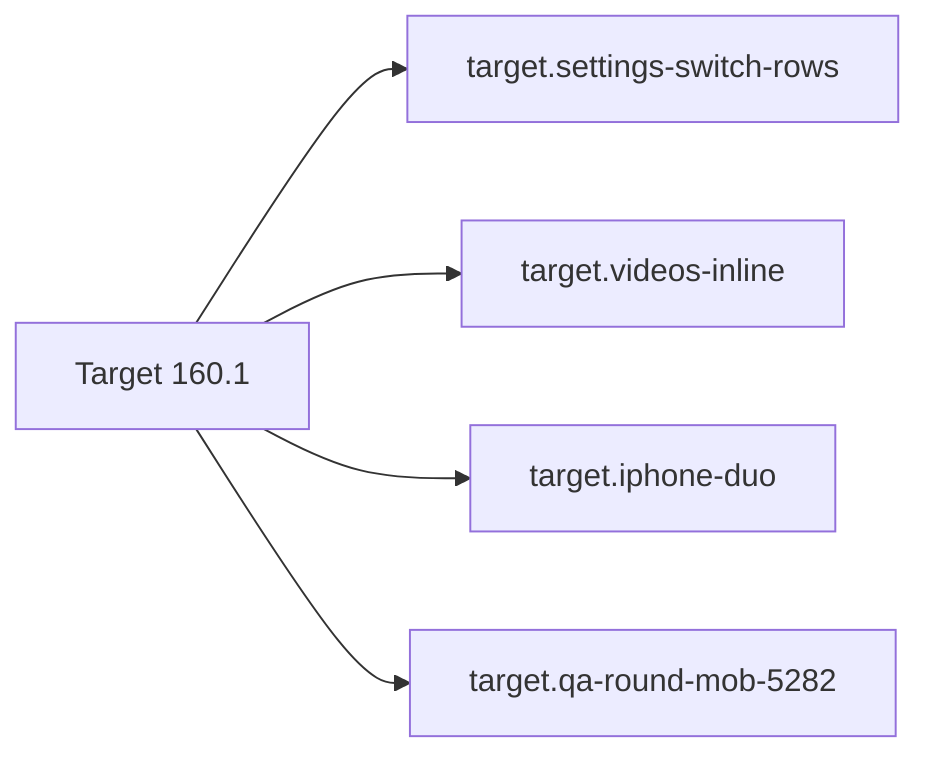

# Target 160.1

What only the upgrade from Firefox 147 to 160.1 (Ecosia 13.0.0, epic MOB-5026) needs on top of the area files. Sources: the inventories [159.1](../../inventory/159.1.md) and [160.1](../../inventory/160.1.md), the [diary](../../diary/160.md) and the MOB-5282 QA round.

Covers:
- `firefox-ios/EcosiaUpgrade/inventory/160.1.md`

## Intended changes

Differences from production that this upgrade means to bring. A run that finds one records a pass and names it.

| Change | Where | Source |
| --- | --- | --- |
| Pinned shortcut badge is upstream's small template pin (`pinExtraSmall`), not main's filled badge | homepage shortcuts | diary 160.md, MOB-5037 |
| Address bar swipe up opens the tab tray, for everyone | toolbar | diary 160.md, MOB-5042 (2026-11-17) |
| Translations, on-device page summaries and the AI controls hub exist (main has them off) | address bar, menu, settings | product decisions in force |
| Firefox's refreshed (Acorn) icons where Ecosia doesn't replace the icon | menus, toolbar | inventory 160.1 |
| Settings switch rows use caption-size detail text; rows with a value on the right keep body size | settings | inventory 160.1 (FXIOS-17242) |
| Settings row borders on iOS 18 and padding on iOS 26 | settings | inventory 160.1 (FXIOS-17065) |
| "Open in Private Tab" in the link context menu | web content | inventory 160.1 (FXIOS-14918) |
| Videos play inline by default | web content | inventory 159.1 (FXIOS-15411) |

## Migrations

Upstream data and preference changes between 147 and 160.1. MOB-5046 lists them all; each needs an `update from main` flow, here or in [update-paths.md](../areas/update-paths.md).

- **Address bar position:** upstream's `migrateBottomBarPositionToTopOnIPad` is never called by Ecosia (diary 160.md, MOB-5039). Covered by `update-paths.settings` (address bar position).
- **Ad blocker preference:** the flag stays off; a user who never saw it has no preference to migrate. Covered by `removed-features.no-entry-points`.
- **`.vpnFeature` user preference** (160.0): defaults to `false`, only `VPNManager` sets it. Nothing to migrate while VPN is out.
- **Start screen default** (found by the [2026-11-25 agent run](../runs/160.1/2026-11-25-agent-iphone13mini-de.md)): Firefox 159.1 changed `start-at-home-feature.setting`'s default from `afterFourHours` to `disabled`, and the 159.1 merge took it. Production opens the homepage after four hours; the upgrade opens the last tab, for new users and for updating users who never changed the setting. Not an intended change: restore `afterFourHours` in Ecosia's block of the YAML and lock it in `FeatureConfigurationTests`. Covered by `settings.structure` and `update-paths.settings`.
- *MOB-5046 adds the rest here.*

## target.settings-switch-rows
p1 · origin inventory 160.1 (FXIOS-17242, 17240, 17065)

Settings rows after upstream's 160.x cell changes: switch rows, detail text, bold text, borders and padding.

**Setup:** fresh install · de · compare with main

1. Screenshot every settings screen that has switches and every screen with values on the right.

**Expect:** rows look like main except the intended changes above; no row with bold text that main shows regular; no clipped borders.

## target.videos-inline
p2 · origin inventory 159.1 (FXIOS-15411)

Videos on websites play inline.

**Setup:** existing · en

1. Open a page with an HTML5 video (for example a Wikipedia article with a video), tap play.

**Expect:** the video plays inside the page; fullscreen is still available.

## target.iphone-duo
p2 · origin inventory 159.1 (iPhone Duo layouts)

Ecosia's toolbar, homepage and onboarding on an iPhone Duo, closed and open.

**Setup:** fresh install · en

1. On an iPhone Duo simulator: onboarding, homepage and a website with the device closed, half open and open (`set_posture` in the simulator tool). Screenshot each.

**Expect:** nothing overlaps or is cut off; the app fills the lit screen. Compare with main where main runs on the Duo.

## target.qa-round-mob-5282
p1 · origin MOB-5282

The regressions German QA found by hand stay fixed. Each has its own flow: `ai-features.translate-icon`, `homepage.layout`, `settings.detail-font`, `settings.homepage-entry-points`, `settings.help-center-locale`, `l10n.german-sweep`.

**Setup:** fresh install · de · compare with main

1. Run the six flows above on an iPhone 13 mini.

**Expect:** all six pass.
